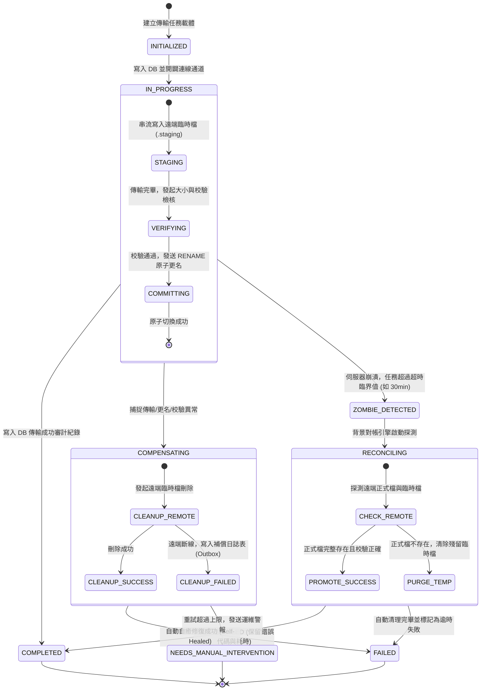

# 檔案傳輸模組需求清單與架構優化 (BackLog.md)

本文件用於記錄專案中暫時擱置、待評估或規劃於未來迭代中實現的技術債、架構優化與功能擴展項目。

---

## 項目清單 (Backlog Items)

### [BL-001] EDA (Event-Driven Architecture) 事件驅動架構設計與優化

* **項目類別**：架構優化 / 功能擴展 (Architectural Optimization / Future Feature)
* **當前狀態**：規劃中 / 暫時擱置 (Deferred / Shelved)
* **優先級別**：Medium (中等)
* **紀錄日期**：2026-10-17

#### 1. 背景與決策緣由 (Context & Decision)
* **初步設計**：
  模組初期採用領域驅動設計 (DDD) 的事件驅動架構 (EDA)，由傳輸工作階段實體 (`TransmissionSession`) 累積領域事件，並在應用層使用案例 (`UploadFileUseCase`, `DownloadFileUseCase`, `SyncDirectoryUseCase`) 執行完畢後，透過輸出埠 (`TransmissionEventPublisherPort`) 發布領域事件至 Spring `ApplicationEventPublisher` 內部匯流排。
* **擱置決策**：
  考量本專案定位為獨立檔案傳輸功能模組，核心聚焦於 FTP、FTPS、SFTP 協定傳輸與目錄同步之穩定性與型別安全性。現階段若維持完整的 EDA，將帶來額外的事件契約版本控管、非同步追蹤成本與測試 mock 負擔。因此依據架構精簡原則，**暫時捨棄 EDA**，將傳輸階段精簡為純粹的狀態流轉實體 (`TransmissionSession` Entity)，解除對事件發布的依賴。

---

#### 2. 原設計資產與事件契約存檔 (Design Assets & Specifications)
未來重啟 EDA 時，可直接沿用以下已定義完整的領域事件與六角形架構合約：

##### (1) 領域事件契約 (Domain Events)
| 事件名稱 | 觸發時機 | 攜帶重要資料 |
| :--- | :--- | :--- |
| `FileUploadedEvent` | 單一檔案上傳成功至遠端主機後觸發 | `sessionId`, `protocol`, `sourcePath`, `targetPath`, `fileName`, `fileSizeBytes` |
| `FileDownloadedEvent` | 單一檔案自遠端主機下載至本機後觸發 | `sessionId`, `protocol`, `sourcePath`, `targetPath`, `fileName`, `fileSizeBytes` |
| `DirectorySynchronizedEvent` | 本機與遠端目錄同步完成後觸發 | `sessionId`, `protocol`, `direction`, `localDir`, `remoteDir`, `transferredCount`, `deletedCount` |

##### (2) 六角形架構埠與適配器 (Ports & Adapters)
* **Outbound Port (應用層合約)**：
  - `com.example.demo.application.port.out.TransmissionEventPublisherPort`
  - 核心方法：`void publish(Object event);`
* **Outbound Adapter (基礎設施適配器)**：
  - `com.example.demo.infrastructure.adapter.TransmissionEventPublisherAdapter`
  - 實作技術：`org.springframework.context.ApplicationEventPublisher`

---

#### 3. 未來重啟 EDA 的觸發條件 (Trigger Conditions & Roadmap)
當專案演進滿足下列任一業務或非功能性需求時，應評估重新引入 EDA：

1. **稽核與軌跡日誌 (Audit Logging)**：
   - 需要將所有傳輸成功的檔案名、大小、起訖時間非同步寫入 Elasticsearch、關聯式資料庫或獨立稽核系統。
2. **非同步通知與告警 (Notifications & Webhooks)**：
   - 傳輸完成後需非同步發送 Webhook 回調、電子郵件、Slack 或 Teams 告警，且通知行為不可阻塞傳輸主執行緒。
3. **分散式訊息匯流排與微服務解耦 (MQ Integration)**：
   - 當本模組需支援高併發或作為微服務獨立運作時，將事件轉發至 Apache Kafka 或 RabbitMQ 供下游消費者（如 ETL 管線、檔案病毒掃描服務）訂閱消費。
4. **即時監控指標 (Prometheus / Grafana Metrics)**：
   - 需透過事件監聽器即時計算檔案傳輸流量、頻寬消耗與傳輸成功率等 APM 監控指標。

---

### [BL-002] 檔案傳輸與資料庫狀態最終一致性與補償機制 (Eventual Consistency & Compensation)

* **項目類別**：可靠性與資料一致性 (Data Consistency / Reliability / Architecture Optimization)
* **當前狀態**：已完成 (Completed)
* **優先級別**：High (高)
* **紀錄日期**：2026-10-17 (2026-10-19 實作完成，185 筆單元與整合測試全數通過，維護手冊參見 [EVENTUAL_CONSISTENCY_AND_COMPENSATION_GUIDE.md](doc/maintainance/EVENTUAL_CONSISTENCY_AND_COMPENSATION_GUIDE.md))

---

#### 1. 背景與異質系統雙寫挑戰 (Background & Dual-Write Challenge)

本模組在執行檔案傳輸時，核心架構涉及兩個本質完全不同的異質系統協同作業：
1. **本機關聯式資料庫 (RDBMS - MSSQL)**：以 ACID 保證紀錄傳輸工作階段實體 (`TransmissionSessionJpaEntity`) 的任務狀態、審計軌跡與耗時統計。
2. **遠端通訊協定端點 (Network File Storage - FTP / FTPS / SFTP)**：透過 Socket 網路資料通道串流寫入實體檔案位元組。

##### 核心技術困境：
* **無分散式交易支援 (No 2PC / XA across File Protocols)**：
  標準 FTP 與 SFTP 協定伺服器不具備分散式交易協同能力（無兩階段提交 2PC 或 XA 事務機制）。此場景本質上屬於經典的**分散式雙寫問題 (Distributed Dual-Write Problem)**，在理論上無法單靠本機資料庫交易達到跨網路的「強一致性 (Strict ACID Consistency)」。
* **長事務反模式 (@Transactional Anti-Pattern)**：
  若在傳輸 UseCase（如 `UploadFileUseCase` 或 `SyncDirectoryUseCase`）上強制標註 `@Transactional`，會引發兩大系統性風險：
  1. **資料庫連線池耗盡 (Connection Pool Exhaustion)**：檔案傳輸依賴遠端網路 I/O，遇到大檔案或網路延遲時耗時可達數十秒至數分鐘，資料庫連線將在整個傳輸期間被鎖死占用，極易拖垮整體微服務系統。
  2. **審計紀錄被抹煞 (Audit Trace Loss on Rollback)**：傳輸失敗拋出例外觸發事務 Rollback 時，原先寫入的初始狀態會被資料庫撤銷，導致系統失去該筆失敗傳輸的完整稽核軌跡。
* **架構決策原則**：
  依據 CAP 定理與微服務設計實踐，本模組**放棄強一致性，全面採用「最終一致性 (Eventual Consistency)」配合「Saga 補償交易 (Compensating Transaction)」與「自癒對帳引擎 (Reconciliation Engine)」**。

---

#### 2. 潛在不一致情境與風險矩陣 (Failure Scenarios & Risk Matrix)

檔案傳輸全生命週期中可能發生的 5 大不一致異常情境：

| 編號 | 異常情境 | 發生原因與時序 | 系統現狀與潛在風險 | 解決策略 |
| :--- | :--- | :--- | :--- | :--- |
| **F-01** | **孤兒檔案<br>(Orphan Files)** | 遠端檔案已完整寫入，但回寫 DB 更新 `COMPLETED` 時遭遇資料庫短暫斷線、鎖逾時或應用崩潰。 | 遠端正式目錄已存在該檔，但 DB 狀態停滯在 `IN_PROGRESS` 或標記為 `FAILED`。調用方誤判傳輸失敗而發起重試，造成檔案覆蓋或重複處理。 | **背景定時對帳自癒**：比對遠端檔案完整性，確認合格後自動補齊 DB 狀態至 `COMPLETED`。 |
| **F-02** | **半截殘缺檔案<br>(Dirty Truncated Files)** | 檔案傳輸到一半（如傳送 70%）遭遇網路中斷或遠端磁碟滿載，傳輸終止。 | 遠端目錄遺留未傳完之殘缺壞檔。若下游排程系統僅根據檔名觸發讀取，將解析出破損資料。 | **暫存檔隔離 + 原子更名**：傳輸時一律寫入臨時檔，全部傳完並校驗後才原子切換為正式檔名。 |
| **F-03** | **殭屍停滯任務<br>(Zombie Sessions)** | 應用程式伺服器遭遇 SIGKILL、容器 OOM 或非預期斷電，未進入 `catch` 或 `finally` 區塊。 | DB 該筆工作階段永遠停留在 `IN_PROGRESS`，缺乏終態，導致監控警報誤報且阻礙後續排程。 | **過期探測清掃 Job**：掃描超時仍未推進的任務，主動探測遠端狀態並轉為終態。 |
| **F-04** | **目錄同步破碎<br>(Partial Sync Inconsistency)** | 目錄同步進行中（例如 100 筆檔案傳輸了 35 筆），傳輸中途網路斷線。 | 目錄狀態部分更新，DB 標記為 `FAILED`。缺乏子項目級別的狀態檢查點，重試時可能重複傳輸或無法對帳。 | **目錄檢查點機制 (Checkpoints)**：記錄單檔項目級別的傳輸成果，支援增量接續傳輸。 |
| **F-05** | **補償動作自我失效<br>(Secondary Failure)** | 傳輸失敗進入 `catch` 區塊發起補償（刪除遠端暫存檔），但此時遠端連線已完全斷絕。 | 補償動作本身失敗，遠端暫存檔永久殘留，長期累積將耗盡遠端磁碟空間與 inode。 | **本地補償日誌表 (Compensation Outbox)**：將未完成的補償任務持久化，由背景工作指數退避重試。 |

---

#### 3. 狀態機模型與生命週期 (State Machine & Transition Flow)

傳輸任務具備完整且不可逆的狀態流轉模型，引入明確的過渡態與補償態：



---

#### 4. 六大核心技術機制與實作藍圖 (Technical Implementation Blueprints)

##### (1) 機制一：兩階段提交模擬 —— 遠端暫存與原子更名 (Staging & Atomic Commit via 2PC)
* **設計精神**：模擬分散式事務的 Prepare 與 Commit 兩階段，杜絕下游讀取到半截檔案。
* **命名慣例 (Naming Convention)**：
  - 正式檔名：`report_20261019.csv`
  - 暫存檔名：`.report_20261019.csv.staging.${trackingId}`（前方帶 `.` 使其在 Linux/Unix SFTP 伺服器上預設為隱藏檔案）。
* **實作流程**：
  1. **Phase 1 (Prepare)**：串流寫入至暫存檔名。若中途斷線，遠端僅存在帶有 `.staging` 之後綴檔。
  2. **Phase 2 (Verify)**：寫入完成後，透過 `GatewayPort.getRemoteFileInfo()` 取得暫存檔實際大小。
  3. **Phase 3 (Commit)**：確認大小與來源一致後，發出協定層 `RENAME` 指令，將暫存檔原子改名為正式檔名。

##### (2) 機制二：完整性多層校驗防線 (Integrity Verification)
* **大小校驗 (Size Check)**：所有協定通用的第一道防線，比對本機傳送位元組與遠端伺服器回傳之 `stat.getSize()`。
* **雜湊校驗 (Checksum / Hash)**：
  - SFTP 協定：若遠端支援 `check-file` (RFC 擴展) 或可透過 SSH 執行 `sha256sum`，進行二進位雜湊比對。
  - FTP / FTPS 協定：若遠端支援 `HASH` 或 `MD5` 命令 (RFC 7151)，執行遠端校驗碼比對。
  - 降級策略：若遠端伺服器不支援校驗碼擴展，維持嚴格大小精確比對（Byte-level Precision）。

##### (3) 機制三：Saga 補償交易與本地補償日誌表 (Saga Pattern & Local Compensation Outbox)
* **設計精神**：解決「補償動作本身失敗」導致的資源洩漏問題。
* **資料表規劃 (`transmission_compensation_log`)**：
  ```sql
  CREATE TABLE transmission_compensation_log (
      compensation_id   BIGINT IDENTITY(1,1) PRIMARY KEY,
      tracking_id       NVARCHAR(64) NOT NULL,
      action_type       NVARCHAR(32) NOT NULL, -- DELETE_REMOTE_STAGING, RENAME_BACK, DELETE_LOCAL_ORPHAN
      credential_id     NVARCHAR(64) NOT NULL,
      remote_path       NVARCHAR(1000) NOT NULL,
      retry_count       INT NOT NULL DEFAULT 0,
      max_retries       INT NOT NULL DEFAULT 5,
      status            NVARCHAR(32) NOT NULL, -- PENDING, RETRYING, SUCCESS, ABANDONED
      error_message     NVARCHAR(MAX) NULL,
      next_retry_at     DATETIME2 NOT NULL,
      created_at        DATETIME2 NOT NULL DEFAULT SYSUTCDATETIME(),
      updated_at        DATETIME2 NOT NULL DEFAULT SYSUTCDATETIME()
  );
  CREATE INDEX idx_comp_pending ON transmission_compensation_log (status, next_retry_at);
  ```
* **運作邏輯**：
  1. 當傳輸發生異常且遠端即時清理失敗時，將補償指令寫入此表（狀態為 `PENDING`）。
  2. 背景補償排程 (`CompensationWorker`) 依據 `next_retry_at` 指數退避 (Exponential Backoff: 1m, 2m, 5m, 10m, 30m) 進行重試。
  3. 超過最大重試次數後標記為 `ABANDONED` 並發送監控告警通知維運人員。

##### (4) 機制四：背景對帳引擎與自癒排程 (Reconciliation & Self-Healing Engine)
* **設計精神**：處理伺服器非預期崩潰（宕機、OOM）產生的殭屍任務。
* **對帳演算法 (Reconciliation Algorithm)**：
  ```java
  @Scheduled(fixedDelayString = "${transmission.reconciliation.interval-ms:600000}") // 預設每 10 分鐘
  public void sweepZombieSessions() {
      Instant threshold = Instant.now().minus(Duration.ofMinutes(30));
      List<TransmissionSessionJpaEntity> zombies = sessionRepo.findZombies(TransmissionStatus.IN_PROGRESS, threshold);

      for (TransmissionSessionJpaEntity session : zombies) {
          reconcileSingleSession(session);
      }
  }
  ```
* **單筆探測邏輯**：
  1. 連線至遠端主機檢查正式檔案：
     - 若正式檔案存在且大小完全吻合 &rarr; 判定傳輸實質成功，自動將 DB 更新為 `COMPLETED`，附註 `[RECONCILED_SUCCESS]`。
  2. 若正式檔案不存在，檢查是否存在 `.staging` 暫存檔：
     - 若存在暫存檔 &rarr; 刪除暫存檔，將 DB 更新為 `FAILED`，錯誤原因註記 `[ZOMBIE_TIMEOUT_PURGED]`。
  3. 若兩者皆不存在 &rarr; 直接將 DB 更新為 `FAILED`，註記 `[ABRUPT_TERMINATION]`。

##### (5) 機制五：目錄同步斷點檢查點 (Directory Sync Checkpointing)
* **設計精神**：防止目錄包含數百個檔案時，因單一檔案失敗導致整個目錄判定失敗且重新傳輸。
* **實作方式**：
  - 為目錄同步引進子項目紀錄表 (`transmission_session_item`)：
    記錄每個子檔案的相對路徑、大小、個別傳輸狀態 (`PENDING`, `SUCCESS`, `SKIPPED`, `FAILED`)。
  - 當同步中途中斷再次觸發時，比對子項目表與時間戳記，跳過已傳輸成功之項目，僅針對未完成之檔案續傳。

##### (6) 機制六：樂觀鎖保護並發狀態 (Optimistic Locking)
* 在 `TransmissionSessionJpaEntity` 增加 `@Version private Long version;` 欄位。
* 當背景對帳引擎在掃描並嘗試改寫狀態時，若剛好與傳輸完成的非同步工作執行緒發生競爭，樂觀鎖機制將阻斷衝突並引發重試，確保狀態流轉絕對具備原子性。

---

#### 5. 資料庫綱要異動規格 (Database Schema DDL)

##### (1) `transmission_session` 資料表擴充
```sql
ALTER TABLE transmission_session ADD version BIGINT NOT NULL DEFAULT 0;
ALTER TABLE transmission_session ADD stage NVARCHAR(32) NULL; -- STAGING, VERIFYING, COMMITTING
ALTER TABLE transmission_session ADD checksum NVARCHAR(128) NULL;
ALTER TABLE transmission_session ADD staging_path NVARCHAR(1000) NULL;
ALTER TABLE transmission_session ADD reconciled BIT NOT NULL DEFAULT 0;
```

##### (2) `transmission_session_item` 新增子項目明細表
```sql
CREATE TABLE transmission_session_item (
    item_id           BIGINT IDENTITY(1,1) PRIMARY KEY,
    session_id        BIGINT NOT NULL,
    file_name         NVARCHAR(255) NOT NULL,
    relative_path     NVARCHAR(1000) NOT NULL,
    file_size_bytes   BIGINT NOT NULL,
    status            NVARCHAR(32) NOT NULL, -- SUCCESS, FAILED, SKIPPED
    error_message     NVARCHAR(MAX) NULL,
    transferred_at    DATETIME2 NOT NULL DEFAULT SYSUTCDATETIME(),
    CONSTRAINT fk_session_item FOREIGN KEY (session_id) REFERENCES transmission_session(id) ON DELETE CASCADE
);
CREATE INDEX idx_item_session ON transmission_session_item (session_id);
```

---

#### 6. 六角形架構影響範圍與元件異動清單 (Hexagonal Architecture Impact Analysis)

本重構遵循 DDD 與六角形架構設計準則，確保領域與應用層邊界純粹：

| 架構分層 | 模組與檔案位置 | 具體職責與變更內容 |
| :--- | :--- | :--- |
| **應用層 Inbound Ports**<br>`application/port/in/` | `ReconcileTransmissionUseCase.java`<br>`ProcessCompensationUseCase.java` | 定義對帳掃描與補償執行的業務合約介面。 |
| **應用層 Outbound Ports**<br>`application/port/out/` | `FileTransmissionGatewayPort.java`<br>`TransmissionCompensationStoragePort.java` | 1. 擴充 Gateway 介面：`renameRemoteFile`、`deleteRemoteFileIfExists`、`getRemoteFileSize`。<br>2. 宣告補償日誌與檢查點的持久化合約。 |
| **應用層服務**<br>`application/service/` | `FileTransmissionCommandService.java`<br>`TransmissionCompensationService.java`<br>`TransmissionReconciliationService.java` | 1. 編排「暫存上傳 &rarr; 校驗 &rarr; 原子重命名」業務流水線。<br>2. 實作例外捕捉後的即時補償與 Outbox 轉發。<br>3. 實作定時對帳與自癒邏輯。 |
| **應用層共享數值物件**<br>`application/shared/vo/` | `TransmissionStage.java`<br>`IntegrityCheckResult.java`<br>`CompensationAction.java` | 定義傳輸階段過渡態、完整性檢查結果與補償行為類型。 |
| **基礎設施層適配器**<br>`infrastructure/adapter/` | `FileTransmissionGatewayAdapter.java`<br>`TransmissionCompensationStorageAdapter.java` | 呼叫技術客戶端執行實際的更名與刪除，並對接 JPA Repository。 |
| **傳輸協定客戶端**<br>`infrastructure/transmission/client/impl/` | `FtpTransmissionClient.java`<br>`FtpsTransmissionClient.java`<br>`SftpTransmissionClient.java` | 封裝各協定底層的原子更名指令：<br>- SFTP：`ChannelSftp.rename()`<br>- FTP / FTPS：`FTPClient.rename()` |
| **基礎設施持久層**<br>`infrastructure/persistence/` | `TransmissionCompensationJpaEntity.java`<br>`TransmissionSessionItemJpaEntity.java` | 提供補償日誌表與檢查點明細表之 Spring Data JPA Repository 與 Entity。 |
| **配置層**<br>`config/` | `ReconciliationSchedulerConfig.java` | 配置 `@EnableScheduling`、對帳執行緒池與時間間隔參數。 |

---

#### 7. 驗證與測試策略 (Testing & Verification Strategy)

* **故障注入單元測試 (Fault-Injection Unit Tests)**：
  - 模擬串流寫入到 50% 時拋出 `SocketTimeoutException`，斷言觸發補償清理並驗證遠端暫存檔被刪除。
  - 模擬更名 (`rename`) 失敗時，斷言寫入 `transmission_compensation_log`。
* **併發競態整合測試 (Concurrent Race-Condition Tests)**：
  - 模擬主執行緒寫入 `COMPLETED` 同時背景對帳掃描該筆紀錄，驗證 `@Version` 樂觀鎖能正確處理 `OptimisticLockingFailureException`。
* **對帳自癒場景測試 (Self-Healing Job Tests)**：
  - 插入一筆 40 分鐘前建立且仍處於 `IN_PROGRESS` 之測試資料，Mock 遠端檔案存在，觸發對帳 Job 後驗證狀態正確自癒晉升為 `COMPLETED`。


---

### [BL-003] 分散式傳輸冪等性與防重複上傳機制 (Distributed Idempotency & Deduplication)

* **項目類別**：高可用性與分散式並發控制 (Distributed Concurrency Control / Idempotency / High Availability)
* **當前狀態**：規劃中 / 待排程 (Planned / Backlog)
* **優先級別**：High (高)
* **紀錄日期**：2026-10-17

#### 1. 背景與核心問題分析 (Background & Problem Analysis)
在微服務與叢集多節點 (Multiple Pods / Instances) 部署架構下，檔案傳輸常面臨重複請求與競爭並發風險：
1. **上游呼叫重試 (Client / Gateway Retry)**：當網路暫時性抖動或傳輸耗時較長時，API Gateway 或調用方客戶端可能自動重試，導致多個節點同時發起相同檔案之上傳。
2. **多節點同時寫入衝突 (Concurrent Write Corruption)**：
   - 目前實作（如 `SftpTransmissionClient`）直接以 `sftp.put(inputStream, filename)` 寫入目標路徑。
   - 若節點 A 與節點 B 同時向遠端伺服器上傳同名檔案，將發生 I/O 寫入衝突，造成遠端檔案內容交錯損毀或資料不完整。
3. **無預警靜默覆蓋 (Silent Overwrite)**：後完成的請求會直接覆蓋先完成的檔案，造成歷史版本丟失且缺乏審計軌跡。
4. **缺乏業務冪等性 (Lack of Idempotency)**：API 請求未攜帶業務唯一標識，系統重複耗費網路頻寬與 I/O 資源重複傳輸相同內容。

---

#### 2. 規劃之改造方案矩陣 (Transformation Solutions Matrix)

為解決分散式重複上傳問題，規劃以下四種不同深度與依賴程度之技術改造方案：

| 方案名稱 | 適用場景 | 外部相依性 | 核心實作技術 | 優點 | 限制與注意事項 |
| :--- | :--- | :--- | :--- | :--- | :--- |
| **方案 1：遠端檔案衝突檢查 + 臨時檔原子重命名** | 輕量化獨立模組部署、無 Redis/DB 中介 | **零外部相依** (僅依賴 SFTP/FTP 本身協定) | `exists()` 預檢 + `.tmp.<id>` 上傳 + `rename()` | 架構最簡潔，開箱即用，能避免傳輸中檔案損壞與覆蓋 | 在毫秒級高並發下，兩節點同時執行 `exists()` 仍可能存在極小時間差 (Race Condition) |
| **方案 2：全域業務冪等鍵 + 資料庫唯一約束** | 專案已具備關聯式資料庫 (RDBMS) | **關聯式資料庫** (PostgreSQL / MySQL) | `idempotencyKey` + `UNIQUE INDEX` | 資料庫級強一致性保證，自然支援狀態快取與查詢回傳 | 依賴資料庫交易，大檔案高並發請求仍會觸發短暫連線開銷 |
| **方案 3：分散式鎖機制 (Distributed Lock)** | 微服務高並發叢集、分散式排程環境 | **Redis / Redisson** | `RLock` / Lua Script + Watchdog 續租 | 即時阻斷跨節點並發重複請求，支援鎖等待與重試 | 需引入並維運 Redis 基礎設施叢集 |
| **方案 4：防護縱深綜合防禦架構 (推薦最終形態)** | 金融級、企業級關鍵檔案傳輸場景 | **Redis + DB + 協定端點** | 分層過濾：API 冪等鍵 &rarr; Redis 分散式鎖 &rarr; DB 唯一索引 &rarr; 遠端暫存原子更名 | 防護最周密，兼顧防重、防損、可追蹤與故障自癒 | 開發與維運成本相對較高 |

---

#### 3. 各方案詳細技術實作規範 (Detailed Technical Specifications)

##### (1) 方案 1：遠端檔案衝突檢查與原子重命名 (Remote Existence & Atomic Rename)
* **實作流程**：
  1. **存在預檢 (Pre-check)**：
     - `FileTransmissionGatewayPort` 擴充 `boolean exists(TransmissionServerConfig config, RemoteFilePath remotePath, String filename)`。
     - 若檔案已存在且請求參數 `overwrite` 為 `false`，直接拋出 `FileAlreadyExistsException`（表現層對應回傳 `HTTP 409 Conflict`）。
  2. **隔離寫入 (Isolated Upload)**：
     - 上傳目標暫定為遠端臨時檔名：`${filename}.uploading.${trackingId}`。
  3. **原子提交 (Atomic Commit)**：
     - 傳輸完成且大小驗證無誤後，透過協定層執行原子更名：`RENAME ${filename}.uploading.${trackingId} -> ${filename}`。
     - 若遠端已存在同名檔案（且允許覆蓋），依協定支援度先刪除舊檔或原子置換。

##### (2) 方案 2：業務冪等鍵與資料庫防重 (Idempotency Key & DB Unique Constraint)
* **實作流程**：
  1. **請求層增加冪等標識**：
     - 在 `UploadFileResource` 與 `UploadFileCommand` 中新增 `idempotencyKey` 欄位（可由客戶端 Header `X-Idempotency-Key` 提供，或依 `SHA-256(localFileContent) + targetPath` 計算產生）。
  2. **資料庫唯一約束**：
     - 在傳輸工作階段表建立唯一索引：
       ```sql
       ALTER TABLE transmission_session ADD CONSTRAINT uk_transmission_idempotency_key UNIQUE (idempotency_key);
       ```
  3. **應用層狀態流轉處理**：
     - 寫入時若捕獲 `DataIntegrityViolationException`，反查該 `idempotencyKey` 紀錄：
       - 若狀態為 `COMPLETED` &rarr; 直接返回先前傳輸成功的快取結果（保證冪等性）。
       - 若狀態為 `IN_PROGRESS` &rarr; 拋出 `TransmissionInProgressException`（回傳 `HTTP 409 Conflict` 或 `HTTP 202 Accepted`，告知正在處理中）。

##### (3) 方案 3：分散式鎖機制 (Distributed Lock via Redisson)
* **實作流程**：
  1. **鎖鍵規則 (Lock Key Pattern)**：
     - 鍵名採用目標端點資源唯一標識：`lock:transmission:upload:{host}:{remotePath}:{filename}`。
  2. **鎖定生命週期 (Lock Lifecycle)**：
     ```java
     RLock lock = redissonClient.getLock(lockKey);
     // 嘗試獲取鎖：最多等待 3 秒，上鎖成功後由 Watchdog 自動續租（防止長傳輸時鎖逾時釋放）
     if (lock.tryLock(3, TimeUnit.SECONDS)) {
         try {
             // 執行預檢、傳輸與狀態記錄
         } finally {
             lock.unlock();
         }
     } else {
         throw new ConcurrentTransmissionException("已有相同的檔案傳輸正在進行中，請勿重複提交: " + filename);
     }
     ```
  3. **降級與重試 (Fallback & Retry)**：
     - 未取得鎖之節點可直接快速失敗（Fast-Fail），或註冊監聽等待鎖釋放後直接獲取傳輸成果。

---

#### 4. 預期涉及之元件與套件異動 (Expected Affected Components)

* **表現層 (Presentation Layer)**：
  - `UploadFileResource`：新增可選之 `idempotencyKey` 屬性。
  - `GlobalExceptionHandler`：新增 `FileAlreadyExistsException` (409) 與 `ConcurrentTransmissionException` (409/429) 之異常處理分支。
* **應用層 (Application Layer)**：
  - `UploadFileCommand`：新增 `idempotencyKey` 欄位。
  - `FileTransmissionGatewayPort`：新增 `exists()`、`renameFile()` 抽象方法。
  - `FileTransmissionCommandService`：整合冪等鍵檢核、遠端衝突確認與原子重命名流程。
* **基礎設施層 (Infrastructure Layer)**：
  - `SftpTransmissionClient`, `FtpTransmissionClient`, `FtpsTransmissionClient`：實作 `exists` (利用 `sftp.stat()` / `ftp.mlistFile()`) 與更名邏輯。
  - (若選用方案 3) 新增 `DistributedLockPort` (Outbound Port) 與 `RedissonDistributedLockAdapter` (Outbound Adapter)。

