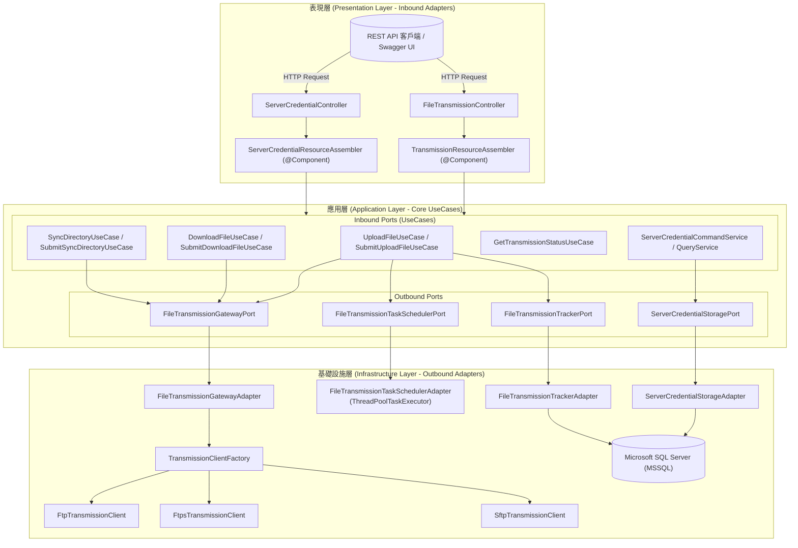

# File Transmission Module (檔案傳輸微服務模組)

[](https://www.oracle.com/java/)
[](https://spring.io/projects/spring-boot)
[](#本地測試與驗證)
[](#架構分層設計-clean-architecture--hexagonal-architecture)
[](LICENSE)

企業級檔案傳輸微服務模組，支援 **FTP**、**FTPS (Explicit TLS)** 與 **SFTP (SSH)** 多傳輸協定，提供檔案同步/非同步上傳、檔案下載、雙向增量目錄同步、記憶體直傳（零磁碟落盤）、動態憑證管理（軟刪除/重生效）與傳輸歷史稽核紀錄。

本專案遵循 **六角形架構 (Hexagonal Architecture / Ports & Adapters)**、**Clean Architecture** 與 **Domain-Driven Design (DDD)** 原則，並建置企業級 AES-256-GCM 憑證加密防護機制。

---

## 目錄

- [核心功能特色](#核心功能特色)
- [架構分層設計 (Clean Architecture & Hexagonal Architecture)](#架構分層設計-clean-architecture--hexagonal-architecture)
- [系統架構圖 (Mermaid)](#系統架構圖)
- [API 介面與功能清單](#api-介面與功能清單)
  - [1. 檔案傳輸端點 (File Transmission API)](#1-檔案傳輸端點-file-transmission-api)
  - [2. 伺服器憑證管理端點 (Server Credential API)](#2-伺服器憑證管理端點-server-credential-api)
- [安全防護與機密機制 (Security Hardening)](#安全防護與機密機制-security-hardening)
- [本地測試與驗證](#本地測試與驗證)
- [本地整合測試環境 (Docker Compose 參考配置)](#本地整合測試環境-docker-compose-參考配置)
- [配置參數說明 (application.properties)](#配置參數說明-applicationproperties)

---

## 核心功能特色

### 1. 多傳輸協定整合與自動容錯
- **FTP (File Transfer Protocol)**：標準明文傳輸，支援被動模式 (Passive Mode / PASV) 穿透防火牆與容器網路。
- **FTPS (Explicit TLS FTP)**：遵循 RFC 4217 標準，支援顯式 `AUTH TLS` 加密，強制執行 `PBSZ 0` 與 `PROT P` (Private) 資料通道最高等級加密，並內建內部自簽憑證信任機制。
- **SFTP (SSH File Transfer Protocol)**：基於 JSch 的 SSH2 安全通道，支援密碼與 SSH 私鑰（本機實體檔案或純文字 PEM 格式，含 Passphrase 解密），提供獨立連線生命週期管理與自動斷開防護。
- **目錄容錯遞迴建立**：當目標遠端多層目錄不存在時，客戶端自動逐層建立目錄並切換，無需外部手動預建。

### 2. 雙模式傳輸場景 (Mode 1 & Mode 2)
- **Mode 1：非同步長任務 (Asynchronous Long-running Task)**：
  - 適用於大檔案或大批次目錄傳輸。
  - 將傳輸任務提交至獨立執行緒池，立即回傳 **HTTP 202 Accepted** 與唯一追蹤碼 `trackingId`。
  - 前端可透過 `/api/transmission/status/{trackingId}` 隨時查詢即時狀態 (`IN_PROGRESS`, `COMPLETED`, `FAILED`) 與傳輸指標。
- **Mode 2：同步傳輸 (Synchronous Task)**：
  - 適用於即時性高的小型檔案傳輸，直接回傳傳輸結果 DTO。
- **記憶體零落盤直傳 (In-Memory Upload)**：
  - 支援前端透過 Multipart 直接上傳檔案串流，以記憶體二進位位元組寫入遠端，**完全不需在本地產生任何實體暫存檔**，根除暫存檔殘留與磁碟 I/O 損耗。
  - 具備智慧相容解析（相容 Swagger UI application/octet-stream、Servlet Part、表單欄位與 ModelAttribute）。
- **目錄雙向智慧增量同步 (Directory Synchronization)**：
  - 支援「本機至遠端」(`LOCAL_TO_REMOTE`) 與「遠端至本機」(`REMOTE_TO_LOCAL`)。
  - 依據最後修改時間 (mtime) 進行智慧增量比對，僅傳輸異動檔案；支援 `deleteRemoteExtras` 選擇性清除遠端孤兒檔案。

### 3. 動態憑證管理與軟刪除機制
- **憑證獨立維護**：支援以別名 (`credentialId`，如 `sftp-main-server`) 綁定主機連線設定，傳輸 Request 僅需傳入 `credentialId` 即可自動解析配置。
- **軟刪除 (Soft Delete) 與重生效**：
  - 刪除憑證時改寫有效狀態為 `N`，保留歷史傳輸紀錄之關聯外鍵與審計追蹤完整性。
  - 提供專屬重生效 API，隨時可一鍵將已軟刪除之憑證復原生效 (`Y`)。
- **資料庫持久化列舉**：以專屬數值物件 `EffectiveStatus` 結合 JPA `AttributeConverter`，在 DB 儲存為純粹字元 `"Y"` 或 `"N"`。

### 4. 企業級安全防護 (Security Hardening)
- **AES-256-GCM 憑證加密**：密碼與金鑰一律採用 AES-GCM 演算法加密存放（格式為 `ENC(...)`），支援多來源主金鑰配置。
- **日誌完全脫敏**：值物件 (`TransmissionServerConfig`) 與回應 DTO 嚴格覆寫 `toString()` 自動遮蔽敏感資訊 (`******`)，杜絕日誌洩漏。
- **Spring Validation 嚴格輸入校驗**：表現層全面導入 Bean Validation (`@Valid` / `@Validated`)，配合防腐層組裝器進行邊界防禦。

---

## 架構分層設計 (Clean Architecture & Hexagonal Architecture)

專案嚴格遵循六角形架構之依賴倒置原則（由外向內依賴，核心領域與應用層零框架侵入）：

```
src/main/java/com/example/demo/
├── application/                          # 【應用服務層】UseCase 業務編排、CQRS 與防腐合約
│   ├── port/
│   │   ├── in/                          # Inbound Ports (UploadFileUseCase, DownloadFileUseCase, 憑證管理...)
│   │   └── out/                         # Outbound Ports (FileTransmissionGatewayPort, ServerCredentialStoragePort...)
│   ├── service/                         # UseCase 服務實作 (CommandService, QueryService)
│   ├── shared/                          # 跨層共用領域數值物件與合約 (Pure POJO / Record)
│   │   ├── command/                     # CQRS Command 物件 (如 UploadFileCommand, SyncDirectoryCommand)
│   │   ├── query/                       # CQRS Query 物件 (如 GetTransmissionStatusQuery)
│   │   ├── dto/                         # 純資料傳輸載體 (如 FileTransmissionGottenResult)
│   │   ├── vo/                          # 實質物件 (TransmissionServerConfig, EffectiveStatus, RemoteFilePath...)
│   │   ├── exception/                   # 領域例外 (FileTransmissionException, TransmissionConnectionException...)
│   │   └── security/                    # 加解密組件 (TransmissionCipher)
│   └── assembler/                       # Application 層 DTO 組裝器
├── infrastructure/                       # 【基礎設施層】技術實作與適配器 (Outbound Adapters)
│   ├── adapter/                         # Outbound 埠適配器 (GatewayAdapter, StorageAdapter, TaskSchedulerAdapter)
│   ├── transmission/                    # 協定通訊客戶端
│   │   ├── factory/                     # TransmissionClientFactory (協定路由工廠)
│   │   └── client/impl/                 # FtpTransmissionClient, FtpsTransmissionClient, SftpTransmissionClient
│   └── persistence/                     # Spring Data JPA 實體與 Repository (MSSQL)
│       ├── credential/                  # ServerCredentialJpaEntity, ServerCredentialJpaRepository
│       └── transmission/                # TransmissionSessionJpaEntity, TransmissionSessionJpaRepository
├── presentation/                         # 【表現層】RESTful Web API (Inbound Adapters)
│   ├── controller/                      # FileTransmissionController, ServerCredentialController
│   ├── resource/
│   │   ├── in/                          # Request Resources (純資料載體，如 UploadFileResource)
│   │   └── out/                         # Response Resources (如 FileUploadedResource, TransmissionStatusGottenResource)
│   ├── assembler/                       # Presentation ACL 組裝器 Component (TransmissionResourceAssembler)
│   └── handler/                         # 全域例外處理器 (GlobalExceptionHandler)
└── config/                              # 【配置層】Spring 配置、執行緒池、OpenAPI 與啟動資料初始化
```

---

## 系統架構圖



---

## API 介面與功能清單

線上 Swagger UI 互動文件位址：`http://localhost:8080/swagger-ui.html`

### 1. 檔案傳輸端點 (File Transmission API)

| HTTP 方法 | API 路徑 | 傳輸模式 | 說明 |
| :--- | :--- | :--- | :--- |
| `POST` | `/api/transmission/upload` | 同步 | 本機檔案推送至遠端主機指定目錄 |
| `POST` | `/api/transmission/upload/async` | 非同步 (Mode 1) | 提交檔案上傳長任務，回傳 202 Accepted 與 `trackingId` |
| `POST` | `/api/transmission/upload/file` | 記憶體直傳 | 上傳 Multipart 檔案，不落地直接以串流推送至遠端 |
| `POST` | `/api/transmission/download` | 同步 | 從遠端伺服器下載檔案至本機目標路徑 |
| `POST` | `/api/transmission/download/async` | 非同步 (Mode 1) | 提交檔案下載長任務，回傳 202 Accepted 與 `trackingId` |
| `POST` | `/api/transmission/sync` | 同步 | 執行目錄雙向比對增量同步 (`LOCAL_TO_REMOTE` / `REMOTE_TO_LOCAL`) |
| `POST` | `/api/transmission/sync/async` | 非同步 (Mode 1) | 提交目錄同步長任務，回傳 202 Accepted 與 `trackingId` |
| `GET` | `/api/transmission/status/{trackingId}` | 查詢 | 依據 `trackingId` 查詢非同步傳輸進度、狀態與詳細指標 |

#### 請求範例：記憶體零落盤檔案上傳 (Multipart Direct Upload)
```bash
curl -X POST "http://localhost:8080/api/transmission/upload/file" \
  -H "Content-Type: multipart/form-data" \
  -F "file=@sample.pdf" \
  -F "credentialId=sftp-main-server" \
  -F "remotePath=/upload" \
  -F "filename=sample.pdf"
```

#### 請求範例：非同步提交下載任務 (Mode 1)
```bash
curl -X POST "http://localhost:8080/api/transmission/download/async" \
  -H "Content-Type: application/json" \
  -d '{
    "credentialId": "sftp-main-server",
    "remoteFilePath": "/upload/monthly_report.zip",
    "savedLocalPath": "D:/downloads/monthly_report.zip"
  }'
```
回應：
```json
{
  "trackingId": "tx-20261018-001",
  "protocol": "SFTP",
  "status": "IN_PROGRESS",
  "message": "傳輸任務已成功受理並於背景非同步執行中",
  "submittedAt": "2026-10-18T23:30:00Z"
}
```

---

### 2. 伺服器憑證管理端點 (Server Credential API)

| HTTP 方法 | API 路徑 | 說明 |
| :--- | :--- | :--- |
| `POST` | `/api/credentials` | 註冊或更新傳輸憑證（自動執行 AES-256-GCM 加密） |
| `GET` | `/api/credentials` | 查詢所有有效憑證清單（密碼自動脫敏 `******`） |
| `GET` | `/api/credentials/{id}` | 依 ID 或別名查詢單一憑證詳情（密碼脫敏） |
| `DELETE` | `/api/credentials/{id}` | **軟刪除憑證**（將有效狀態標記為 `N`，保留歷史數據） |
| `POST` | `/api/credentials/{id}/enable` | **重新生效憑證**（將已軟刪除之憑證復原標記為 `Y`） |

#### 請求範例：註冊 SFTP 憑證
```bash
curl -X POST "http://localhost:8080/api/credentials" \
  -H "Content-Type: application/json" \
  -d '{
    "credentialId": "sftp-main-server",
    "host": "127.0.0.1",
    "port": 2222,
    "protocol": "SFTP",
    "username": "tester",
    "password": "password",
    "timeoutMs": 5000,
    "passiveMode": true,
    "strictHostKeyChecking": false
  }'
```

---

## 安全防護與機密機制 (Security Hardening)

1. **密碼密文格式 (ENC Format)**：
   - 伺服器密碼存入資料庫時，一律透過 `TransmissionCipher` 進行 AES-256-GCM 認證加密，存放格式為 `ENC(Base64密文)`。
   - 應用層在發起傳輸握手前，自動解密為原始連線密碼，全程不落盤。
2. **外部化主金鑰配置**：
   - 透過環境變數注入（推薦生產環境）：
     ```bash
     export TRANSMISSION_SECRET_KEY="<32位元組Base64編碼金鑰>"
     ```
   - 或透過 `application.properties` 設定：
     ```properties
     transmission.security.secret-key=${TRANSMISSION_SECRET_KEY:DefaultBase64EncodedKey}
     ```
3. **物件不可變性與脫敏日誌**：
   - `TransmissionServerConfig` 為 Java `record` 不可變數值物件。
   - 覆寫 `toString()` 自動將密碼與 SSH 私鑰遮蔽為 `******`，防止誤印日誌。

---

## 本地測試與驗證

本專案具備完整單元測試與整合測試，覆蓋所有 UseCase、防腐層組裝器、各協定客戶端 (FTP/FTPS/SFTP) 與例外轉譯機制。

執行所有單元測試：
```bash
.\mvnw.cmd test
```

測試驗證成果：
```text
[INFO] Results:
[INFO] Tests run: 169, Failures: 0, Errors: 0, Skipped: 0
[INFO] ------------------------------------------------------------------------
[INFO] BUILD SUCCESS
[INFO] ------------------------------------------------------------------------
```

> [!NOTE]
> 專案內所有單元測試方法皆採用 **BDD / Gherkin 語法 Javadoc (Feature, Scenario, Given-When-Then)** 撰寫，清晰展現驗證情境與預期行為。

---

## 本地整合測試環境 (Docker Compose 參考配置)

專案 `docker-compose/` 目錄提供開箱即用的本地整合測試環境（包含 SFTP、FTP、FTPS、FileBrowser 檔案管理 UI 與 MSSQL）：

```bash
cd docker-compose
docker-compose up -d
```

### 服務連線資訊清單

| 服務名稱 | 容器名稱 | 對外通訊埠 | 預設帳號 / 密碼 | 說明 |
| :--- | :--- | :--- | :--- | :--- |
| **SFTP Server** | `mock-sftp-server` | `2222` | `tester` / `password` | SSH File Transfer Protocol (目錄: `/home/tester/upload`) |
| **FTP Server** | `mock-ftp-server` | `2121` (被動埠 21100-21110) | `tester` / `password` | 標準 FTP 伺服器 |
| **FTPS Server** | `mock-ftps-server` | `2122` (被動埠 21120-21130) | `tester` / `password` | FTPS (Explicit TLS / PROT P) |
| **FileBrowser UI** | `mock-file-manager-ui`| `8088` | 免登入 (`--noauth`) | 視覺化檔案管理 Web 介面，可即時查看傳輸檔案 |
| **MSSQL 2022** | `mock-mssql-server` | `1433` | `sa` / `Root@123456` | 系統資料庫 (資料庫名稱: `file-transmission`) |

> [!TIP]
> 啟動容器後，可直接透過瀏覽器訪問 `http://localhost:8088`，即時在視覺化檔案管理器中檢驗 FTP / FTPS / SFTP 所接收到的上傳與同步檔案。

---

## 配置參數說明 (application.properties)

主要配置項目如下：

```properties
# 服務與資料庫 (MSSQL)
spring.application.name=file-transmission-module
spring.datasource.url=jdbc:sqlserver://localhost:1433;databaseName=file-transmission;trustServerCertificate=true;encrypt=false;sendStringParametersAsUnicode=true
spring.datasource.username=sa
spring.datasource.password=Root@123456
spring.jpa.hibernate.ddl-auto=create

# 非同步傳輸執行緒池 (Mode 1 Async ThreadPool)
transmission.async.core-pool-size=4
transmission.async.max-pool-size=16
transmission.async.queue-capacity=100
transmission.async.thread-name-prefix=transmission-async-

# Multipart 檔案上傳上限 (Mode 2 Memory Upload)
spring.servlet.multipart.max-file-size=50MB
spring.servlet.multipart.max-request-size=50MB

# 安全加解密配置
transmission.security.secret-key=${TRANSMISSION_SECRET_KEY:}

# OpenAPI & Swagger UI
springdoc.swagger-ui.path=/swagger-ui.html
springdoc.swagger-ui.enabled=true

# 最終一致性與自癒對帳排程 (BL-002)
transmission.reconciliation.enabled=true
transmission.reconciliation.interval-ms=600000
transmission.reconciliation.threshold-minutes=30

# Saga 補償交易 Outbox 排程 (BL-002)
transmission.compensation.enabled=true
transmission.compensation.interval-ms=60000
transmission.compensation.max-retries=5
```

---

## 架構手冊與維護指南文件庫 (Documentation Index)

專案詳細架構設計、安全性與生產維運手冊統一歸檔於 `doc/maintainance/` 目錄：

| 手冊名稱 | 檔案路徑 | 核心內容與涵蓋範圍 |
| :--- | :--- | :--- |
| **上傳任務同步 vs 非同步與長任務架構指南** | [`UPLOAD_TASK_SYNC_VS_ASYNC_AND_LONG_RUNNING_GUIDE.md`](doc/maintainance/UPLOAD_TASK_SYNC_VS_ASYNC_AND_LONG_RUNNING_GUIDE.md) | 上傳任務非同步 (202 Accepted) 與同步 (200 OK) 之連線執行緒模型、一般任務 (零落盤直傳) 與長任務 (2PC 暫存更名、Saga Outbox 補償、對帳自癒) 之本質區別與選型決策樹。 |
| **檔案傳輸最終一致性與補償機制指南** | [`EVENTUAL_CONSISTENCY_AND_COMPENSATION_GUIDE.md`](doc/maintainance/EVENTUAL_CONSISTENCY_AND_COMPENSATION_GUIDE.md) | **[BL-002] 核心機制**：兩階段暫存與更名 (2PC)、Saga 補償 Outbox 表、背景對帳自癒引擎、樂觀鎖衝突自癒與生產監控 SQL。 |
| **同步 vs 非同步長任務架構指南** | [`SYNC_VS_ASYNC_TRANSMISSION_GUIDE.md`](doc/maintainance/SYNC_VS_ASYNC_TRANSMISSION_GUIDE.md) | Mode 1 (非同步長任務 202 Accepted) 與 Mode 2 (同步傳輸 200 OK) 之執行緒模型、逾時風險與適用場景對比矩陣。 |
| **憑證金庫與 AES-GCM 金鑰手冊** | [`CREDENTIAL_AND_AES_KEY_ARCHITECTURE_GUIDE.md`](doc/maintainance/CREDENTIAL_AND_AES_KEY_ARCHITECTURE_GUIDE.md) | 遠端密碼、SSH 私鑰與內部 AES-GCM 加密主金鑰（AEAD 防竄改與隨機 IV）的定位差異與加解密生命週期。 |
| **傳輸協定客戶端技術剖析指南** | [`TRANSMISSION_CLIENTS_ANALYSIS_GUIDE.md`](doc/maintainance/TRANSMISSION_CLIENTS_ANALYSIS_GUIDE.md) | FTP (Commons Net)、FTPS (PROT P 加密) 與 SFTP (JSch SSH2) 底層連線池、被動模式穿透與遞迴目錄處理。 |
| **系統安全性維護指南** | [`SECURITY_MAINTENANCE_GUIDE.md`](doc/maintainance/SECURITY_MAINTENANCE_GUIDE.md) | 憑證軟刪除復原機制、全域防禦、審計軌跡保護與安全加固建議。 |

