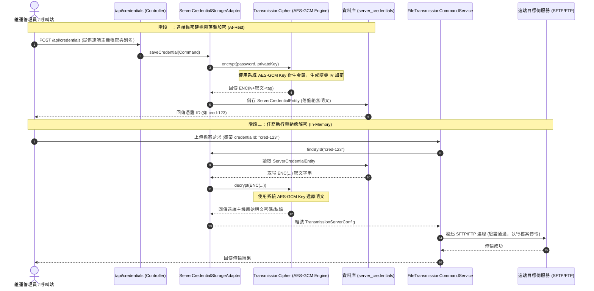

# 傳輸憑證角色定位與內部 AES-GCM 加密金鑰架構手冊 (CREDENTIAL_AND_AES_KEY_ARCHITECTURE_GUIDE.md)

本文件專為**後端開發人員**、**維運維護工程師 (DevOps / SRE)** 與**架構師**撰寫，詳細剖析 `file-transmission-module` 內部的各類帳號密碼、SSH 金鑰、內部 AES-GCM 加密主金鑰的業務歸屬、角色定位與端到端加解密生命週期。

---

## 目錄
- [一、 核心概念：3 種密碼 / 金鑰的本質與角色對照](#一-核心概念3-種密碼--金鑰的本質與角色對照)
- [二、 AES-GCM 內部加密金鑰的核心特性](#二-aes-gcm-內部加密金鑰的核心特性)
  - [2.1 為什麼選擇 AES-GCM？(AEAD 特性)](#21-為什麼選擇-aes-gcm-aead-特性)
  - [2.2 密碼學規格表](#22-密碼學規格表)
- [三、 端到端運作流程：憑證金庫與傳輸連線](#三-端到端運作流程憑證金庫與傳輸連線)
  - [3.1 流程圖解 (Mermaid Architecture)](#31-流程圖解-mermaid-architecture)
  - [3.2 階段一：憑證建檔與落盤加密 (At-Rest Encryption)](#32-階段一憑證建檔與落盤加密-at-rest-encryption)
  - [3.3 階段二：任務執行與動態解密 (In-Memory Decryption)](#33-階段二任務執行與動態解密-in-memory-decryption)
- [四、 相關程式碼元件與架構分層映射](#四-相關程式碼元件與架構分層映射)
- [五、 維運配置與環境變數設定指南](#五-維運配置與環境變數設定指南)

---

## 一、 核心概念：3 種密碼 / 金鑰的本質與角色對照

在檔案傳輸模組中，常會接觸到「密碼」、「私鑰」與「金鑰」，必須清楚區分其所屬主體與安全範圍：

| 密碼 / 金鑰名稱 | 所屬主體 (歸誰管) | 儲存位置 | 核心職責與用途 |
| :--- | :--- | :--- | :--- |
| **1. 遠端主機登入密碼<br>(Remote Server Password)** | **遠端傳輸目標伺服器**<br>(FTP / FTPS / SFTP Host) | 遠端主機系統帳號庫 (如 Linux `/etc/shadow` 或 FTP 使用者庫) | 供本系統連線遠端伺服器時通過身分驗證 (M2M 機器對機器連線)。**絕非本系統操作人員密碼**。 |
| **2. SFTP SSH 私鑰與 Passphrase<br>(SSH Private Key / Passphrase)** | **遠端主機授權金鑰** | 授權公鑰存於遠端主機 `authorized_keys`；私鑰由呼叫端或憑證金庫保管 | 用於 SFTP 協定之非對稱公私鑰免密碼認證；Passphrase 則保護私鑰檔案本身。 |
| **3. AES-GCM 內部加密主金鑰<br>(★ 本題主角 - AES-GCM Secret Key)** | **本應用程式模組自己** | 本系統設定檔 `application.properties` 或環境變數 `TRANSMISSION_SECURITY_SECRET_KEY` | **本模組專用的「保險箱鑰匙」**。專門將上述 1 與 2 的機密在存入資料庫前加密為 `ENC(...)` 密文，保護落盤安全。**遠端目標伺服器完全不知道它的存在**。 |

> 💡 **直觀的比喻**：
> * **遠端主機密碼 / SSH 私鑰**：相當於你去客戶辦公室拜訪時，客戶大門的**門禁密碼或感應卡**。
> * **AES-GCM 內部金鑰**：相當於你回到自己公司，把客戶的大門門禁密碼鎖進**自己公司內部保險箱**時所使用的**保險箱鑰匙**。

---

## 二、 AES-GCM 內部加密金鑰的核心特性

### 2.1 為什麼選擇 AES-GCM？(AEAD 特性)
傳統的對稱加密（例如 AES-CBC 或 AES-ECB）存在以下弱點：
1. **ECB 模式安全性不足**：相同明文會產出相同密文，容易遭受模式分析攻擊。
2. **CBC 模式易受 Padding Oracle 攻擊**：需要額外的填補（Padding），且本身不具備防竄改驗證能力。

因此，本模組採用業界標準最高級別的 **AES-GCM (Galois/Counter Mode)**，屬於 **AEAD (Authenticated Encryption with Associated Data)**：
* **認證防竄改 (Integrity & Authentication)**：加密資料時，會自動產生 128-bit 認證標籤 (Auth Tag)。若資料在庫中或傳輸中遭到任何 1 個 bit 的惡意竄改，解密程序將直接失敗並拒絕使用。
* **隨機動態 IV (Dynamic Initialization Vector)**：每次加密透過 `SecureRandom` 產生全新的 12-byte IV，**即便兩次加密完全相同的密碼，產生的密文也完全不同**，徹底杜絕彩虹表比對。
* **無填補機制 (No Padding)**：作為串流計數器模式，杜絕 Padding Oracle 密碼學弱點。

### 2.2 密碼學規格表

| 項目 | 規格標準 | 實作說明 |
| :--- | :--- | :--- |
| **演算法** | AES-GCM | `AES/GCM/NoPadding` |
| **金鑰長度** | 128-bit (16 Bytes) | 透過 SHA-256 自動均勻衍生任意輸入字串為 128-bit 金鑰 |
| **隨機 IV 長度** | 12 Bytes (96-bit) | 每次加密獨立隨機動態生成，並附加於密文前置字元 |
| **驗證標籤長度** | 128-bit (16 Bytes) | GCM 自動校驗資料完整性 |
| **密文包裝格式** | `ENC(<Base64_IV_Cipher_Tag>)` | 帶有 `ENC(...)` 標籤，便於系統辨識是否已加密 |

---

## 三、 端到端運作流程：憑證金庫與傳輸連線

### 3.1 流程圖解 (Mermaid Architecture)



---

### 3.2 階段一：憑證建檔與落盤加密 (At-Rest Encryption)
1. 維運人員呼叫憑證管理 API（例如建立連線別名為 `TW-BANK-SFTP` 的憑證）。
2. 在寫入資料庫之前，[`ServerCredentialStorageAdapter`](file:///d:/桌面/ModuleWorkSpace/file-transmission-module/src/main/java/com/example/demo/infrastructure/adapter/ServerCredentialStorageAdapter.java) 調用 [`TransmissionCipher`](file:///d:/桌面/ModuleWorkSpace/file-transmission-module/src/main/java/com/example/demo/application/shared/security/TransmissionCipher.java)。
3. 使用內部 AES-GCM Key 將密碼、私鑰、通行碼加密成 `ENC(base64)` 格式。
4. 存入 [`ServerCredentialEntity`](file:///d:/桌面/ModuleWorkSpace/file-transmission-module/src/main/java/com/example/demo/infrastructure/persistence/credential/entity/ServerCredentialEntity.java)，對應資料表 `server_credentials`。
5. **安全效益**：即使資料庫管理者（DBA）直接檢視資料庫，或資料庫備份檔案遭竊，亦無法獲取任何明文帳密。

---

### 3.3 階段二：任務執行與動態解密 (In-Memory Decryption)
1. 傳輸調度端（排程作業或前端）發起檔案傳輸，請求中**僅需提供 `credentialId`（或 alias）**。
2. 傳輸服務向儲存埠請求該憑證，底層自動使用內部 AES-GCM Key 將 `ENC(...)` 密文動態解密為記憶體中的明文。
3. 組裝為應用層純粹數值物件 [`TransmissionServerConfig`](file:///d:/桌面/ModuleWorkSpace/file-transmission-module/src/main/java/com/example/demo/application/shared/vo/TransmissionServerConfig.java)。
4. 傳輸閘道底層客戶端（Apache Commons VFS / JSch）使用還原後的明文密碼或 SSH 私鑰與遠端目標主機進行連線握手。
5. 傳輸結束後，記憶體物件自然釋放；連線日誌中透過覆寫的 `toString()` 自動脫敏（顯示為 `******`），確保任何環節皆不外洩機密。

---

## 四、 相關程式碼元件與架構分層映射

依據 Clean Architecture 與 DDD 規範，各類機密與密鑰相關元件精準定位於各層次：

```
src/main/java/com/example/demo/
├── config/                                        # 配置層 (The Dirtiest Layer)
│   ├── properties/
│   │   └── TransmissionSecurityProperties.java    # 綁定 transmission.security.secret-key 內部 AES 金鑰
│   └── config/
│       └── FileTransmissionConfig.java            # 註冊加解密埠實例與組裝 Beans
├── application/                                   # 應用層
│   ├── port/out/
│   │   ├── CredentialCipherPort.java              # 加解密抽象輸出埠
│   │   └── ServerCredentialStoragePort.java       # 伺服器憑證持久化輸出埠
│   └── shared/
│       ├── security/
│       │   └── TransmissionCipher.java            # 純 Java AES-GCM 密碼學引擎 (零框架依賴)
│       └── vo/
│           └── TransmissionServerConfig.java      # 傳輸連線配置純粹值物件 (具日誌脫敏能力)
└── infrastructure/                                # 基礎設施層
    ├── adapter/
    │   ├── CredentialCipherAdapter.java           # 實作加解密輸出埠之適配器
    │   └── ServerCredentialStorageAdapter.java    # 整合資料庫與透明 AES-GCM 加解密之憑證庫適配器
    └── persistence/credential/entity/
        └── ServerCredentialEntity.java            # 伺服器憑證資料庫 ORM 實體 (落盤加密欄位)
```

---

## 五、 維運配置與環境變數設定指南

### 5.1 內部 AES-GCM Key 之設定方式
本模組提供多層次金鑰注入支援，各環境應遵循最小權限與隔離原則：

#### 1. 開發環境 (`application.properties`)
預設具備開發測試備用金鑰，供本機測試免配置即開即用：
```properties
# 預設開發測試金鑰 (非生產環境使用)
transmission.security.secret-key=FileTxModule@2026SecKey!
```

#### 2. 生產環境 (Production) - 環境變數注入 (強烈推薦)
在容器化 (Docker/K8s) 或 Linux 伺服器中，**嚴禁**將正式金鑰寫入設定檔，應透過環境變數注入：
```bash
# Linux / Docker 環境變數
export TRANSMISSION_SECURITY_SECRET_KEY="MyCompany@Prod2026_SecureKey_#998"
```

```yaml
# Kubernetes Deployment Pod 範例
env:
  - name: TRANSMISSION_SECURITY_SECRET_KEY
    valueFrom:
      secretKeyRef:
        name: file-tx-secrets
        key: aes-master-key
```

### 5.2 金鑰遺失或不一致之後果警告
> ⚠️ **重要警示**：
> 資料庫中 `server_credentials` 所有的密碼與私鑰均是由 **AES-GCM Key** 加密儲存。
> 若生產環境更換或遺失了該金鑰，已儲存的所有 `ENC(...)` 密文將無法被正確解密（會拋出 GCM 驗證標籤不合之例外）。因此：
> 1. 請務必妥善保管生產環境的 `TRANSMISSION_SECURITY_SECRET_KEY`。
> 2. 若欲進行金鑰輪換（Key Rotation），需透過批次工具：先用舊金鑰解密所有憑證，再以新金鑰重新加密並更新至資料庫。
