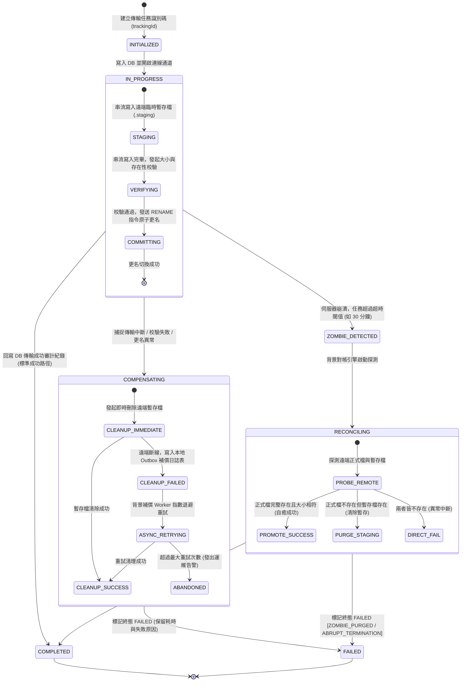
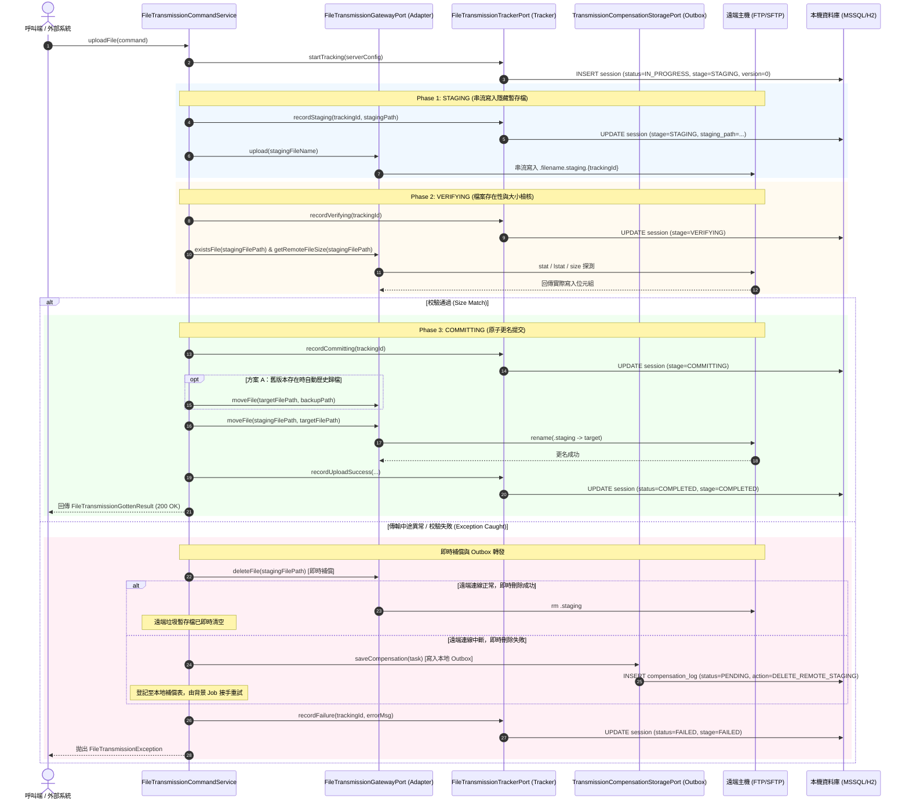
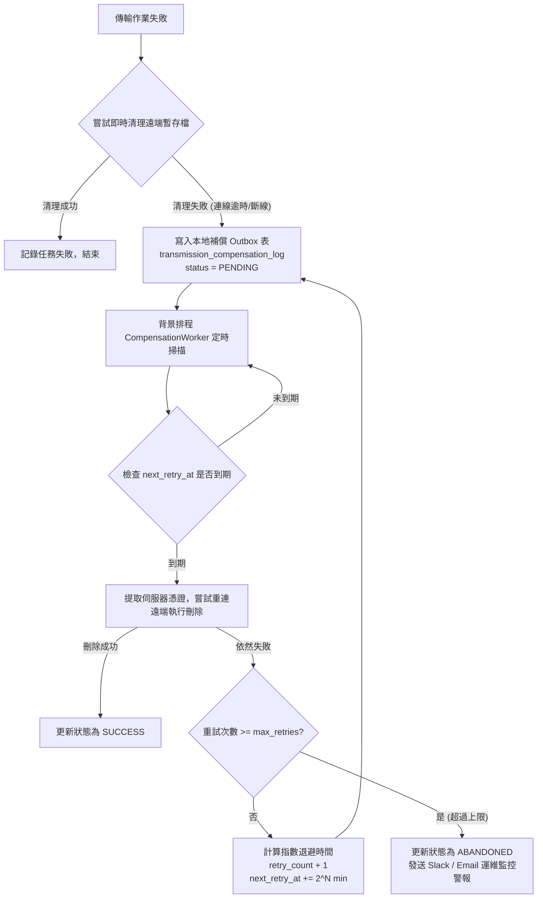

# 檔案傳輸與資料庫狀態最終一致性與補償機制架構維護指南 (Eventual Consistency & Compensation Guide)

> **版本**：1.0.0  
> **適用模組**：`file-transmission-module`  
> **關聯項目**：`[BL-002]` 檔案傳輸與資料庫狀態最終一致性與補償機制  
> **維護路徑**：`doc/maintainance/EVENTUAL_CONSISTENCY_AND_COMPENSATION_GUIDE.md`  
> **建立時間**：2026-10-19  

---

## 目錄

- [一、 核心背景與分散式雙寫挑戰](#一-核心背景與分散式雙寫挑戰)
  - [1.1 異質系統協同的本質困境](#11-異質系統協同的本質困境)
  - [1.2 為什麼禁止在傳輸方法標註 `@Transactional`？](#12-為什麼禁止在傳輸方法標註-transactional)
  - [1.3 CAP 定理抉擇：全面擁抱最終一致性](#13-cap-定理抉擇全面擁抱最終一致性)
- [二、 潛在不一致情境與風險矩陣 (Failure Matrix)](#二-潛在不一致情境與風險矩陣-failure-matrix)
- [三、 狀態機模型與生命週期流轉 (State Machine)](#三-狀態機模型與生命週期流轉-state-machine)
  - [3.1 狀態機狀態遷移圖 (Statechart)](#31-狀態機狀態遷移圖-statechart)
  - [3.2 端到端業務循序圖 (End-to-End Sequence Diagram)](#32-端到端業務循序圖-end-to-end-sequence-diagram)
- [四、 六大核心技術機制深入解析](#四-六大核心技術機制深入解析)
  - [4.1 機制一：兩階段提交模擬 (2PC Staging & Atomic Commit)](#41-機制一兩階段提交模擬-2pc-staging--atomic-commit)
  - [4.2 機制二：傳輸多層完整性防線 (Integrity Verification)](#42-機制二傳輸多層完整性防線-integrity-verification)
  - [4.3 機制三：Saga 補償交易與本地補償日誌表 (Compensation Outbox)](#43-機制三saga-補償交易與本地補償日誌表-compensation-outbox)
  - [4.4 機制四：背景對帳引擎與殭屍任務自癒 (Reconciliation Engine)](#44-機制四背景對帳引擎與殭屍任務自癒-reconciliation-engine)
  - [4.5 機制五：目錄同步斷點檢查點機制 (Directory Sync Checkpoints)](#45-機制五目錄同步斷點檢查點機制-directory-sync-checkpoints)
  - [4.6 機制六：樂觀鎖並發版本控制與自癒重試 (Optimistic Locking)](#46-機制六樂觀鎖並發版本控制與自癒重試-optimistic-locking)
- [五、 資料庫綱要異動與實體設計 (Schema DDL)](#五-資料庫綱要異動與實體設計-schema-ddl)
  - [5.1 `transmission_sessions` 擴充欄位](#51-transmission_sessions-擴充欄位)
  - [5.2 `transmission_compensation_log` 補償任務日誌表](#52-transmission_compensation_log-補償任務日誌表)
  - [5.3 `transmission_session_item` 目錄子項目明細表](#53-transmission_session_item-目錄子項目明細表)
- [六、 六角形架構與程式碼元件對照](#六-六角形架構與程式碼元件對照)
- [七、 維運配置與生產故障排除手冊 (DevOps Runbook)](#七-維運配置與生產故障排除手冊-devops-runbook)
  - [7.1 生產環境組態參數 (application.properties)](#71-生產環境組態參數-applicationproperties)
  - [7.2 核心監控 SQL 與維運檢核指令](#72-核心監控-sql-與維運檢核指令)
  - [7.3 常見故障與標準排除程序 (Troubleshooting SOP)](#73-常見故障與標準排除程序-troubleshooting-sop)

---

## 一、 核心背景與分散式雙寫挑戰

### 1.1 異質系統協同的本質困境

在傳統企業應用中，檔案傳輸通常被視為單純的 I/O 操作。但在微服務與分散式系統視角下，本模組實質上正在調度兩個本質截然不同的異質儲存媒介：

```
                +-----------------------------------------------------+
                |        FileTransmissionCommandService (應用層)      |
                +-----------------------------------------------------+
                                   /                         \
            (Local ACID Transaction)             (Unreliable Network Streaming)
                                 /                             \
                                v                               v
                +------------------------+          +------------------------+
                | 本機資料庫 (RDBMS)      |          | 遠端檔案端點 (FTP/SFTP)|
                | MSSQL / H2             |          | Linux / Windows Host   |
                | 審計狀態與歷史紀錄     |          | 實體檔案與二進位串流   |
                +------------------------+          +------------------------+
```

1. **本機關聯式資料庫 (RDBMS - MSSQL / H2)**：具備嚴格的 ACID 交易保證，能確保傳輸階段歷程（`TransmissionSessionEntity`）的原子性與一致性。
2. **遠端通訊協定端點 (FTP / FTPS / SFTP)**：透過 Socket 長連線進行 TCP 串流寫入。協定本身**不具備分散式事務機制 (No 2PC / XA Transaction)**，不支援「若資料庫寫入失敗則自動復原遠端檔案」的能力。

這構成了經典的**分散式雙寫問題 (Distributed Dual-Write Problem)**。

---

### 1.2 為什麼禁止在傳輸方法標註 `@Transactional`？

在檔案傳輸 UseCase（如 `UploadFileUseCase`、`SyncDirectoryUseCase`）上標註 Spring 的 `@Transactional` 註解是**嚴重的架構反模式 (Architectural Anti-Pattern)**：

1. **資料庫連線池耗竭 (Connection Pool Exhaustion)**：
   - 檔案傳輸屬於耗時不可控的網路 I/O 操作（數百 MB 大檔或跨國慢速網路耗時可達數十秒至數分鐘）。
   - 若開啟 `@Transactional`，該執行緒在整個網路傳輸期間都會占用資料庫連線池（如 HikariCP）中的 Connection，導致短時間內連線耗盡，造成其他高頻 API 阻塞癱瘓。
2. **審計軌跡全面遺失 (Audit Trail Loss on Rollback)**：
   - 當遠端傳輸遇到網路斷線或權限不足拋出例外時，Spring 事務管理器會將整筆事務強制 Rollback。
   - 事務撤銷會將一開始寫入的傳輸開始紀錄連帶清除，使得資料庫內「查無此任務」，系統無法留下任何故障稽核軌跡，嚴重違反金融與企業審計規範。

---

### 1.3 CAP 定理抉擇：全面擁抱最終一致性

基於分散式系統理論，在無法取得跨網路強一致性 (Strict Consistency) 的前提下：
* 本模組**放棄同步強一致性**；
* 採用 **BASE 理論 (Basically Available, Soft-state, Eventual Consistency)**；
* 透過**兩階段提交模擬 (2PC Staging)**、**Saga 補償機制 (Compensating Transaction)** 與 **背景自癒對帳引擎 (Reconciliation Engine)**，保證系統在任意節點崩潰或網路抖動下，皆能達成**資料庫狀態與遠端檔案的最終一致性**。

---

## 二、 潛在不一致情境與風險矩陣 (Failure Matrix)

在傳輸全生命週期中，可能發生的 5 大異常情境與本模組的解決對策：

| 編號 | 異常情境 (Failure Scenario) | 發生時序與根因 | 潛在業務風險 | 本模組之解決對策 |
| :--- | :--- | :--- | :--- | :--- |
| **F-01** | **孤兒檔案<br>(Orphan Files)** | 遠端檔案已完整傳輸並更名成功，但在回寫 DB 更新狀態為 `COMPLETED` 時，資料庫短暫斷線、鎖逾時或應用崩潰。 | 遠端已存在合格正式檔案，但 DB 停留在 `IN_PROGRESS` 或記為失敗。呼叫方可能發起重傳，造成重複扣款或重複處理。 | **背景定時對帳自癒**：探測遠端正式檔案存在且大小無誤時，自動將 DB 補齊升級為 `COMPLETED`，附註 `[RECONCILED_SUCCESS]`。 |
| **F-02** | **半截殘缺檔案<br>(Dirty Truncated Files)** | 檔案傳輸到一半（如 65%）時網路突發中斷或遠端磁碟滿載，傳輸中途終止。 | 遠端目錄遺留破損的殘缺檔案。若下游排程系統依據檔名定時提取，將讀取到不完整資料導致解析崩潰。 | **暫存隔離 + 原子更名 (2PC)**：傳輸時一律寫入隱藏暫存檔 (`.staging`)，全檔傳輸且大小驗證通過後才以 `rename` 原子切換。 |
| **F-03** | **殭屍停滯任務<br>(Zombie Sessions)** | 應用伺服器發生 OOM (Out Of Memory)、遭系統 `kill -9`、容器重啟或非預期斷電，未進入 `catch` 或 `finally`。 | DB 該任務工作階段永久停留在 `IN_PROGRESS`，永遠沒有終態，引發監控警報誤報且阻塞後續排程。 | **超時殭屍清掃 Job**：背景掃描超過超時閾值（如 30 分鐘）仍未更新的任務，主動探測遠端狀態並進行收斂。 |
| **F-04** | **目錄同步破碎<br>(Partial Sync Inconsistency)** | 目錄同步進行中（例如共 100 個檔案，傳至第 45 個時斷線）。 | 目錄呈現部分同步狀態，若無子項目追蹤，下次重試無法得知哪些檔案已同步，易造成全量重複傳輸。 | **檢查點明細表 (`session_item`)**：記錄子檔案項目級別的傳輸成果，支援斷點識別與增量續傳。 |
| **F-05** | **補償動作二次失效<br>(Secondary Failure)** | 傳輸失敗進入 `catch` 區塊發起即時清理（刪除遠端暫存檔），但此時遠端網路已完全阻斷。 | 補償動作本身失敗，暫存檔永久殘留於遠端，日積月累將耗盡遠端儲存空間與 inode。 | **本地補償日誌表 (Saga Outbox)**：將清理任務持久化至本地 Outbox 表，由背景排程以指數退避演算法非同步重試。 |

---

## 三、 狀態機模型與生命週期流轉 (State Machine)

### 3.1 狀態機狀態遷移圖 (Statechart)

傳輸任務具備不可逆的狀態流轉模型，包含內部細部作業階段（`stage`）與全域終態（`status`）：



---

### 3.2 端到端業務循序圖 (End-to-End Sequence Diagram)

以下為檔案上傳（`uploadFile`）涵蓋「暫存上傳 &rarr; 校驗 &rarr; 原子更名 &rarr; 異常補償 &rarr; Outbox 轉發」的完整循序圖：



---

## 四、 六大核心技術機制深入解析

### 4.1 機制一：兩階段提交模擬 (2PC Staging & Atomic Commit)

#### 設計核心：
為避免傳輸中途網路斷線在遠端留下半截檔案，模擬分散式事務的 **Prepare** 與 **Commit** 階段：

* **暫存檔命名規範 (Naming Convention)**：
  - 正式檔案路徑：`/upload/monthly_report_202610.csv`
  - 暫存檔案路徑：`/upload/.monthly_report_202610.csv.staging.${trackingId}`
  - *命名細節*：檔名前方帶有 `.`，在 Linux/Unix SFTP 伺服器中預設為隱藏檔案，確保未傳完前下游排程與一般使用者不可見；後方帶有 `${trackingId}` UUID，確保多執行緒並發上傳同名檔案時互不衝突。
* **流程拆解**：
  1. **Phase 1 (Prepare / STAGING)**：串流寫入暫存檔。若此時中斷，遠端僅存在帶有 `.staging` 的垃圾檔，不影響業務目錄。
  2. **Phase 2 (VERIFYING)**：完成寫入後，主動發起檔案大小檢核（Byte-level Precision）。
  3. **Phase 3 (Commit / COMMITTING)**：檢核通過後，發出檔案系統原子指令更名為正式檔名。

---

### 4.2 機制二：傳輸多層完整性防線 (Integrity Verification)

#### 檢核層級：
1. **第一道防線：大小精確比對 (Size Check - Mandatory)**：
   - 跨所有協定（FTP, FTPS, SFTP）百分之百支援。
   - 上傳完成後，調用 `gatewayPort.getRemoteFileSize(config, stagingFilePath)` 比對遠端實際寫入位元組是否與本地來源長度相等。若長度不符，立即中斷流程並觸發補償。
2. **第二道防線：雜湊比對 (Checksum / Hash - Optional)**：
   - **SFTP**：若遠端支援 RFC Draft `check-file` 擴展或允許執行 SSH 指令，可進一步計算 SHA-256 進行逐位元比對。
   - **FTP/FTPS**：若伺服器支援 RFC 7151，可發送 `HASH` 或 `MD5` 擴展指令比對。
   - **優雅降級**：若遠端主機為精簡型 FTP Server 不支援雜湊擴展，系統平滑降級為大小精確校驗。

---

### 4.3 機制三：Saga 補償交易與本地補償日誌表 (Compensation Outbox)

#### 設計精神：
解決「補償動作本身失敗」所導致的永久資源洩漏（Secondary Failure）。



#### 指數退避策略 (Exponential Backoff)：
補償任務採用階梯式重試間隔，避免在遠端主機宕機時持續高頻重試浪費系統資源：
- **第 1 次重試**：失敗後 1 分鐘
- **第 2 次重試**：失敗後 2 分鐘
- **第 3 次重試**：失敗後 5 分鐘
- **第 4 次重試**：失敗後 10 分鐘
- **第 5 次重試**：失敗後 30 分鐘
- **超過 5 次**：標記為 `ABANDONED`（放棄自動重試），等待人工介入處理。

---

### 4.4 機制四：背景對帳引擎與殭屍任務自癒 (Reconciliation Engine)

#### 設計精神：
當伺服器因非預期斷電、容器 OOM 或 `kill -9` 強制終止時，記憶體中進行中的任務中斷，資料庫內的 `IN_PROGRESS` 紀錄失去推進者，形成「殭屍任務 (Zombie Sessions)」。

#### 掃描與雙重探測演算法：
對帳排程器（`TransmissionReconciliationService`）依據 `threshold`（預設 30 分鐘）定期檢索逾時的 `IN_PROGRESS` 任務，執行雙重探測：

```mermaid
flowchart TD
    Start[對帳排程觸發: sweepZombieSessions] --> Query[查詢 DB: status = IN_PROGRESS 且 started_at < (now - 30m)]
    Query --> Loop{是否有殭屍任務?}
    Loop -- 無 --> End[結束本輪對帳]
    Loop -- 有 --> Pick[提取單筆任務，解析連線配置]
    Pick --> CheckOfficial{探測遠端正式檔案是否存在?}
    
    CheckOfficial -- 正式檔存在且大小吻合 --> SelfHeal[【自癒成功】<br>更新 DB: status = COMPLETED<br>備註: [RECONCILED_SUCCESS]]
    
    CheckOfficial -- 正式檔不存在 --> CheckStaging{探測遠端暫存檔 .staging 是否存在?}
    
    CheckStaging -- 暫存檔存在 --> CleanStaging[刪除遠端殘留暫存檔]
    CleanStaging --> MarkPurged[更新 DB: status = FAILED<br>備註: [ZOMBIE_TIMEOUT_PURGED]]
    
    CheckStaging -- 暫存檔亦不存在 --> MarkAbrupt[更新 DB: status = FAILED<br>備註: [ABRUPT_TERMINATION]]
    
    SelfHeal --> Next[處理下一筆]
    MarkPurged --> Next
    MarkAbrupt --> Next
    Next --> Loop
```

---

### 4.5 機制五：目錄同步斷點檢查點機制 (Directory Sync Checkpoints)

#### 設計精神：
在進行海量檔案目錄同步時（例如 1000 個檔案），若因網路瞬間抖動導致第 500 個檔案失敗，傳統設計會將整個目錄任務標記為 `FAILED`，下次重試時必須全部重新掃描甚至重新傳輸。

#### 檢查點實作：
- 引入子項目明細表 `transmission_session_item`。
- 每個子檔案在傳輸完成時，即時寫入一筆明細（`file_name`, `relative_path`, `file_size_bytes`, `status=SUCCESS`）。
- 當同一目錄同步任務重新發起時，對帳邏輯比對本機檔案修改時間戳記與資料庫成功檢查點，**自動跳過已傳輸成功之檔案**，僅針對失敗或未完成之檔案進行續傳。

---

### 4.6 機制六：樂觀鎖並發版本控制與自癒重試 (Optimistic Locking)

#### 背景與競態場景：
當非同步背景工作執行緒剛好傳輸完成準備寫入 `COMPLETED` 時，背景對帳排程器正好掃描到該筆紀錄判定超時，兩者同時更新同一筆資料表紀錄時將發生**並發競態 (Race Condition)**。

#### 樂觀鎖保護設計：
1. **實體欄位宣告**：
   在 `TransmissionSessionEntity` 加入 `@Version private Long version;`。
   - *實作細節*：新實體建立時 `version` 必須為 `null`，以便 Spring Data JPA 能正確識別為新物件執行 `persist()`，並在寫入後由 JPA 自動指派初始版本號 `0`。
2. **失敗記錄與重試防護**：
   在 `FileTransmissionTrackerAdapter.recordFailure` 中，採用「優先 DB 查詢 + 樂觀鎖衝突自癒重試」機制：
   ```java
   @Override
   public void recordFailure(String trackingId, String errorMessage) {
       TransmissionSessionEntity inMemory = activeSessions.remove(trackingId);
       if (trackingId == null || trackingId.trim().isEmpty()) {
           return;
       }
       try {
           updateStatusToFailed(trackingId, errorMessage, inMemory);
       } catch (OptimisticLockingFailureException ex) {
           // 發生樂觀鎖版本衝突，重新自 DB 載入最新版實體重試一次，確保失敗審計日誌不遺漏
           updateStatusToFailed(trackingId, errorMessage, inMemory);
       }
   }
   ```
   此機制保證了即便在極端並發競爭下，傳輸失敗審計日誌依然能夠 100% 寫入資料庫，絕不向外拋出未捕捉的內部樂觀鎖異常。

---

## 五、 資料庫綱要異動與實體設計 (Schema DDL)

### 5.1 `transmission_sessions` 擴充欄位

```sql
-- 擴充傳輸階段作業主表 (MSSQL / H2 相容語法)
ALTER TABLE transmission_sessions ADD version BIGINT NOT NULL DEFAULT 0;
ALTER TABLE transmission_sessions ADD stage NVARCHAR(32) NULL;        -- STAGING, VERIFYING, COMMITTING, COMPLETED, FAILED
ALTER TABLE transmission_sessions ADD staging_path NVARCHAR(1024) NULL;-- 遠端暫存檔案完整路徑
ALTER TABLE transmission_sessions ADD reconciled BIT NOT NULL DEFAULT 0;-- 是否經由對帳引擎自癒修復
ALTER TABLE transmission_sessions ADD server_host NVARCHAR(256) NULL; -- 遠端主機 (供對帳引擎自癒連線)
ALTER TABLE transmission_sessions ADD server_port INT NULL;           -- 通訊埠
ALTER TABLE transmission_sessions ADD server_username NVARCHAR(128) NULL; -- 帳號
ALTER TABLE transmission_sessions ADD server_password NVARCHAR(512) NULL; -- 加密密碼
ALTER TABLE transmission_sessions ADD credential_id NVARCHAR(64) NULL;    -- 關聯憑證 ID
```

---

### 5.2 `transmission_compensation_log` 補償任務日誌表

```sql
CREATE TABLE transmission_compensation_log (
    compensation_id   BIGINT IDENTITY(1,1) PRIMARY KEY,
    tracking_id       NVARCHAR(64) NOT NULL,
    action_type       NVARCHAR(32) NOT NULL,    -- DELETE_REMOTE_STAGING, RENAME_BACK, DELETE_LOCAL_ORPHAN
    remote_path       NVARCHAR(1000) NOT NULL,
    protocol          NVARCHAR(16) NOT NULL,    -- FTP, FTPS, SFTP
    server_host       NVARCHAR(256) NOT NULL,
    server_port       INT NOT NULL,
    server_username   NVARCHAR(128) NOT NULL,
    server_password   NVARCHAR(512) NULL,
    credential_id     NVARCHAR(64) NULL,
    retry_count       INT NOT NULL DEFAULT 0,
    max_retries       INT NOT NULL DEFAULT 5,
    status            NVARCHAR(32) NOT NULL,    -- PENDING, RETRYING, SUCCESS, ABANDONED
    error_message     NVARCHAR(MAX) NULL,
    next_retry_at     DATETIME2 NOT NULL,
    created_at        DATETIME2 NOT NULL DEFAULT SYSUTCDATETIME(),
    updated_at        DATETIME2 NOT NULL DEFAULT SYSUTCDATETIME()
);

-- 加速待重試補償任務輪詢效能之複合索引
CREATE INDEX idx_comp_pending ON transmission_compensation_log (status, next_retry_at);
CREATE INDEX idx_comp_tracking ON transmission_compensation_log (tracking_id);
```

---

### 5.3 `transmission_session_item` 目錄子項目明細表

```sql
CREATE TABLE transmission_session_item (
    item_id           BIGINT IDENTITY(1,1) PRIMARY KEY,
    session_id        NVARCHAR(64) NOT NULL,
    file_name         NVARCHAR(255) NOT NULL,
    relative_path     NVARCHAR(1000) NOT NULL,
    file_size_bytes   BIGINT NOT NULL,
    status            NVARCHAR(32) NOT NULL,    -- SUCCESS, FAILED, SKIPPED
    error_message     NVARCHAR(MAX) NULL,
    transferred_at    DATETIME2 NOT NULL DEFAULT SYSUTCDATETIME()
);

CREATE INDEX idx_item_session ON transmission_session_item (session_id);
```

---

## 六、 六角形架構與程式碼元件對照

本模組嚴格遵循 DDD 與六角形架構規範（`AGENTS.md`）：

```
+---------------------------------------------------------------------------------------+
|                                    DOMAIN LAYER                                       |
|  Pure Java Models, VOs, Events & Domain Exceptions (零 Spring / 零 JPA / 零技術框架)    |
+---------------------------------------------------------------------------------------+
                                           ^
                                           | (依賴注入)
+---------------------------------------------------------------------------------------+
|                                  APPLICATION LAYER                                    |
|                                                                                       |
|  [Inbound Ports (Use Cases)]            [Outbound Ports (Contracts)]                  |
|  - ReconcileTransmissionUseCase         - FileTransmissionGatewayPort                 |
|  - ProcessCompensationUseCase           - FileTransmissionTrackerPort                 |
|                                         - TransmissionCompensationStoragePort         |
|                                                                                       |
|  [Application Services]                 [Assemblers & DTOs]                           |
|  - FileTransmissionCommandService       - TransmissionDtoAssembler                    |
|  - TransmissionCompensationService      - ZombieSessionGottenResult                   |
|  - TransmissionReconciliationService    - TransmissionReconciliationGottenResult      |
|                                         - CompensationTask, TransmissionStage (VOs)   |
+---------------------------------------------------------------------------------------+
         ^                                                              ^
         | (實作呼叫)                                                    | (實作適配)
+----------------------------------+          +-----------------------------------------+
|        PRESENTATION LAYER        |          |          INFRASTRUCTURE LAYER           |
|                                  |          |                                         |
|  [Inbound Adapters (Controller)] |          |  [Outbound Adapters]                    |
|  - FileTransmissionController    |          |  - FileTransmissionGatewayAdapter       |
|                                  |          |  - FileTransmissionTrackerAdapter       |
|  [Assemblers & Resources]        |          |  - TransmissionCompensationStorageAdapter|
|  - TransmissionResourceAssembler |          |                                         |
|  - ReconcileExecutionResource    |          |  [Persistence Entities & Repositories]  |
|                                  |          |  - TransmissionSessionEntity & JpaRepo  |
|                                  |          |  - TransmissionCompensationEntity & Repo|
|                                  |          |  - TransmissionSessionItemEntity & Repo |
|                                  |          |                                         |
|                                  |          |  [Protocol Clients]                     |
|                                  |          |  - SftpTransmissionClient               |
|                                  |          |  - FtpTransmissionClient                |
|                                  |          |  - FtpsTransmissionClient               |
+----------------------------------+          +-----------------------------------------+
```

### 具體實作類別清單：

| 元件類型 | 分層位置 | 類別 / 介面名稱 | 職責與架構說明 |
| :--- | :--- | :--- | :--- |
| **Inbound Port** | `application/port/in/` | `ReconcileTransmissionUseCase` | 定義殭屍傳輸工作階段對帳自癒的業務合約。 |
| **Inbound Port** | `application/port/in/` | `ProcessCompensationUseCase` | 定義 Saga 補償重試與清理的業務合約。 |
| **Outbound Port** | `application/port/out/` | `TransmissionCompensationStoragePort` | 定義補償 Outbox 表的持久化與檢索合約。 |
| **Outbound Port** | `application/port/out/` | `FileTransmissionTrackerPort` | 擴充 2PC 階段切換 (`recordStaging`, `recordVerifying`, `recordCommitting`) 與自癒寫入方法。 |
| **Outbound Port** | `application/port/out/` | `FileTransmissionGatewayPort` | 擴充底層遠端更名 (`moveFile`) 與刪除 (`deleteFile`) 契約。 |
| **Application Service** | `application/service/` | `TransmissionReconciliationService` | 實作對帳掃描演算法，調度探測、自癒晉升與逾時清除。 |
| **Application Service** | `application/service/` | `TransmissionCompensationService` | 實作 Saga 補償 Worker，執行指數退避重試與告警。 |
| **Application Service** | `application/service/` | `FileTransmissionCommandService` | 編排上傳流水線（暫存上傳 &rarr; 校驗 &rarr; 原子更名 &rarr; 異常補償）。 |
| **Outbound Adapter** | `infrastructure/adapter/` | `FileTransmissionTrackerAdapter` | 追蹤器適配器，維護實體狀態流轉並具備樂觀鎖衝突重試保護。 |
| **Outbound Adapter** | `infrastructure/adapter/` | `TransmissionCompensationStorageAdapter` | 補償持久化適配器，對接 JPA Repository。 |
| **Protocol Client** | `infrastructure/transmission/client/impl/` | `SftpTransmissionClient`<br>`FtpTransmissionClient`<br>`FtpsTransmissionClient` | 封裝協定底層的原子更名 (`ChannelSftp.rename`, `FTPClient.rename`) 與刪除命令。 |
| **Configuration** | `config/` | `ReconciliationSchedulerConfig` | 啟用 `@EnableScheduling`，配置對帳排程器與重試週期參數。 |

---

## 七、 維運配置與生產故障排除手冊 (DevOps Runbook)

### 7.1 生產環境組態參數 (application.properties)

可於 `application.properties` 或 K8s ConfigMap / 環境變數中覆寫以下設定：

```properties
# ==============================================================================
# 檔案傳輸最終一致性與自癒對帳排程器配置 (Reconciliation Engine)
# ==============================================================================
# 是否啟用背景對帳自癒排程 (預設: true)
transmission.reconciliation.enabled=true

# 背景對帳排程執行頻率 (毫秒，預設: 600,000 ms = 10 分鐘)
transmission.reconciliation.interval-ms=600000

# 殭屍任務判定時間閾值 (分鐘，若 IN_PROGRESS 超過此時間未更新則判定為殭屍，預設: 30 分鐘)
transmission.reconciliation.threshold-minutes=30

# ==============================================================================
# 檔案傳輸 Saga 補償交易 Outbox 排程器配置 (Compensation Worker)
# ==============================================================================
# 是否啟用背景補償重試排程 (預設: true)
transmission.compensation.enabled=true

# 背景補償排程重試掃描頻率 (毫秒，預設: 60,000 ms = 1 分鐘)
transmission.compensation.interval-ms=60000

# 補償任務最大重試次數 (超過此上限標記為 ABANDONED 並觸發告警，預設: 5 次)
transmission.compensation.max-retries=5
```

---

### 7.2 核心監控 SQL 與維運檢核指令

維運人員可直接在資料庫中執行以下 SQL 指令監控傳輸模組之健康狀態：

#### 1. 檢視當前殘留超過 30 分鐘的殭屍任務：
```sql
SELECT id, protocol, status, stage, staging_path, started_at, DATEDIFF(MINUTE, started_at, SYSUTCDATETIME()) AS elapsed_minutes
FROM transmission_sessions
WHERE status = 'IN_PROGRESS'
  AND started_at < DATEADD(MINUTE, -30, SYSUTCDATETIME())
ORDER BY started_at ASC;
```

#### 2. 檢視累積待補償清理之暫存檔清單 (Pending Outbox Tasks)：
```sql
SELECT compensation_id, tracking_id, action_type, remote_path, retry_count, status, next_retry_at, error_message
FROM transmission_compensation_log
WHERE status IN ('PENDING', 'RETRYING')
ORDER BY next_retry_at ASC;
```

#### 3. 檢視已放棄並需要維運手動介入清理的任務 (Abandoned Tasks)：
```sql
SELECT compensation_id, tracking_id, remote_path, retry_count, error_message, updated_at
FROM transmission_compensation_log
WHERE status = 'ABANDONED'
ORDER BY updated_at DESC;
```

#### 4. 統計近 24 小時內經由對帳引擎自癒成功 (Reconciled) 的任務總數：
```sql
SELECT COUNT(1) AS reconciled_count
FROM transmission_sessions
WHERE reconciled = 1
  AND started_at > DATEADD(HOUR, -24, SYSUTCDATETIME());
```

---

### 7.3 常見故障與標準排除程序 (Troubleshooting SOP)

#### 情境一：收到 `ABANDONED` 補償警報 (暫存檔超過重試上限無法刪除)
* **現象說明**：遠端伺服器在傳輸失敗後持續斷線或權限變更，重試 5 次依然無法刪除 `.staging` 檔案。
* **標準作業程序 (SOP)**：
  1. 依據 `transmission_compensation_log` 中的 `remote_path` 與 `server_host`，由維運人員手動透過 SSH / FileZilla 登入遠端主機。
  2. 檢查遠端該路徑是否存在 `.staging` 暫存檔：
     - 若存在：執行 `rm <remote_path>` 手動刪除釋放空間。
     - 若已被其他程序清理：確認無殘留。
  3. 執行 SQL 將狀態標記為已人工排除：
     ```sql
     UPDATE transmission_compensation_log
     SET status = 'RESOLVED_MANUAL', error_message = error_message + ' [已由維運手動清理完畢]'
     WHERE compensation_id = <ID>;
     ```

#### 情境二：傳輸失敗時應用程式日誌出現樂觀鎖警告
* **現象說明**：日誌出現 `[傳輸對帳] 階段狀態更新遭遇樂觀鎖版本衝突 (主執行緒可能正在寫入)，略過本週期: trackingId=...`。
* **處置評估**：**此為正常現象，無需人工介入**。表示傳輸執行緒與對帳排程器正好在同一毫秒嘗試更新任務，樂觀鎖機制已成功阻斷並發衝突，工作執行緒將順利寫入正確終態。

#### 情境三：大批任務呈現 `ZOMBIE_TIMEOUT_PURGED`
* **現象說明**：大量工作階段被對帳引擎標記為失敗並清理暫存檔。
* **處置評估**：通常代表應用程式曾在該時段發生重啟、Pod OOM 被 K8s 終止或與遠端主機之網路發生大面積斷線。請調閱當下時間點之容器系統日誌與 APM 監控，確認是否有記憶體不足或主機當機情事。
