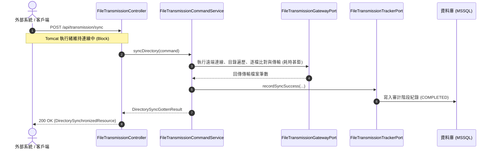
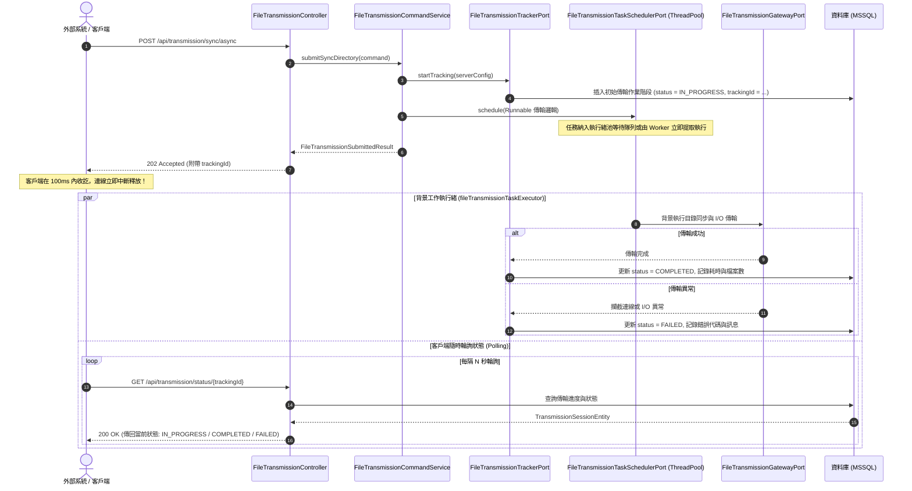

# 檔案傳輸同步 vs 非同步長任務架構維護指南 (Sync vs Async Transmission Guide)

> **版本**：1.0.0  
> **適用模組**：`file-transmission-module`  
> **維護路徑**：`doc/maintainance/SYNC_VS_ASYNC_TRANSMISSION_GUIDE.md`  

---

## 1. 概述與架構背景

在企業級檔案傳輸系統中，傳輸場景的耗時差異極大：
- **微型傳輸**：數 KB 到數 MB 的小型設定檔或文字檔，傳輸耗時通常在 100 毫秒至 1 秒內。
- **長任務傳輸 (Long-Running Task)**：大型目錄同步（如數百至數萬個檔案）、跨網段/跨國慢速網路、GB 級大檔案等，耗時常達數分鐘甚至數小時。

為了兼顧**即時反饋需求**與**高併發下的系統穩定性**，本模組採用了**雙軌設計 (Dual-Track Pattern)**：
1. **同步作業 (Synchronous Execution)**：適用於小檔案與單次快速傳輸。
2. **非同步長任務提交 (Asynchronous Task Submission)**：專門應對目錄同步、大檔傳輸與批次任務，遵循非阻塞架構設計。

---

## 2. 核心架構對比矩陣

| 比較維度 | 同步傳輸 (Sync Execution) | 非同步長任務提交 (Async Task Submission) |
| :--- | :--- | :--- |
| **典型代表 API** | `POST /api/transmission/sync` | `POST /api/transmission/sync/async` |
| **HTTP 狀態碼** | **`200 OK`**（完成後才回應） | **`202 Accepted`**（立即回應任務接收憑證） |
| **回傳載體** | `DirectorySynchronizedResource`<br>包含傳輸總數、耗時等最終數據 | `FileTransmissionSubmittedResource`<br>包含 `trackingId`、`IN_PROGRESS` 狀態 |
| **執行緒模型** | 佔用 **Tomcat Web 請求執行緒 (Worker Thread)** | 立即釋放 Web 執行緒，派發至專屬 **ThreadPoolTaskExecutor** |
| **客戶端連線行為** | **阻塞等待 (Blocking)**，HTTP 連線保持長連 | **非阻塞 (Non-Blocking)**，連線於百毫秒內釋放 |
| **結果獲取模式** | 從本次 Request 的 Response 直接獲取 | 透過 `GET /api/transmission/status/{trackingId}` 輪詢結果 |
| **網路逾時風險** | **極高**。反向代理 (Nginx/Gateway) 預設 60s 易噴 `504 Gateway Timeout` | **零逾時風險**。提交握手在 100ms 內完成 |
| **伺服器負載影響** | 大量長任務會迅速佔滿 Tomcat 執行緒池，引發 **執行緒枯竭 (Thread Starvation)** | 隔離於獨立執行緒池，設有任務佇列緩衝，**不影響整體 Web API 吞吐量** |
| **資料庫審計紀錄** | 傳輸完畢時寫入成功/失敗紀錄 | **提交當下立即寫入 `IN_PROGRESS`**，結束後自動更新審計指標 |
| **適用場景** | 單一小檔案、檔案數量 < 5 的微型目錄同步 | 跨主機目錄全量同步、大量檔案比對、海量檔案傳輸 |

---

## 3. 循序圖與生命週期解析

### 3.1 同步傳輸流程 (Synchronous Flow)



> [!WARNING]
> 若目錄內包含大量檔案或網路延遲較高，同步模式會在傳輸進行中因反向代理（如 Nginx、F5、Cloudflare、AWS ALB）的逾時限制而斷線，造成客戶端判定為失敗，但後端伺服器仍持續寫檔的狀態不一致問題。

---

### 3.2 非同步長任務提交流程 (Asynchronous Submission Flow)



---

## 4. 關鍵程式碼與分層組件對應

### 4.1 表現層 (Presentation Layer)
- **Controller**：[FileTransmissionController.java](file:///d:/桌面/ModuleWorkSpace/file-transmission-module/src/main/java/com/example/demo/presentation/controller/FileTransmissionController.java)
  - `/sync`：直接調用 `syncDirectoryUseCase`，等待完成後包裝成 `DirectorySynchronizedResource`。
  - `/sync/async`：調用 `submitSyncDirectoryUseCase`，即刻回傳 HTTP 202 與 `FileTransmissionSubmittedResource`。
  - `/status/{trackingId}`：調用 `getTransmissionStatusUseCase` 查詢任務目前結果。

### 4.2 應用層 (Application Layer)
- **Command 服務**：[FileTransmissionCommandService.java](file:///d:/桌面/ModuleWorkSpace/file-transmission-module/src/main/java/com/example/demo/application/service/FileTransmissionCommandService.java)
  - 在 `submitSyncDirectory(...)` 中：
    ```java
    // 1. 金鑰解密
    TransmissionServerConfig effectiveConfig = credentialCipherPort.decryptServerConfig(command.serverConfig());
    // 2. 建立資料庫初始追蹤
    String trackingId = fileTransmissionTrackerPort.startTracking(effectiveConfig);
    // 3. 委派至專屬背景調度器
    fileTransmissionTaskSchedulerPort.schedule(() -> {
        try {
            int transferredCount = fileTransmissionGatewayPort.syncDirectory(...);
            fileTransmissionTrackerPort.recordSyncSuccess(trackingId, ...);
        } catch (Exception ex) {
            fileTransmissionTrackerPort.recordFailure(trackingId, ex.getMessage());
        }
    });
    // 4. 立即回傳提交 DTO
    return TransmissionDtoAssembler.toSubmittedResult(trackingId, ...);
    ```

### 4.3 基礎設施與配置層 (Infrastructure & Config Layer)
- **非同步執行緒池配置**：[AsyncTransmissionConfig.java](file:///d:/桌面/ModuleWorkSpace/file-transmission-module/src/main/java/com/example/demo/config/config/AsyncTransmissionConfig.java)
  - 核心執行緒數 (`corePoolSize`)、最大執行緒數 (`maxPoolSize`)、佇列容量 (`queueCapacity`)。
  - 專屬執行緒名稱前綴 `transmission-exec-`，利於日誌過濾與 APM 效能監控。
- **持久化實體**：[TransmissionSessionEntity.java](file:///d:/桌面/ModuleWorkSpace/file-transmission-module/src/main/java/com/example/demo/infrastructure/persistence/transmission/entity/TransmissionSessionEntity.java)
  - 充血模型，完整維護任務狀態 (`IN_PROGRESS`, `COMPLETED`, `FAILED`)、起訖時間戳記、傳輸檔案量與耗時毫秒數。

---

## 5. API 呼叫實戰範例

### 5.1 同步目錄同步呼叫 (適用於極小目錄)

**Request**:
```http
POST /api/transmission/sync HTTP/1.1
Host: localhost:8080
Content-Type: application/json

{
  "host": "sftp.example.com",
  "port": 22,
  "username": "sftpuser",
  "password": "EncryptedAESPasswordBase64String==",
  "protocol": "SFTP",
  "localDir": "D:/data/upload-source",
  "remoteDir": "/remote/data-target",
  "direction": "LOCAL_TO_REMOTE",
  "deleteRemoteExtras": false
}
```

**Response (HTTP 200 OK - 傳輸結束後回傳)**:
```json
{
  "protocol": "SFTP",
  "direction": "LOCAL_TO_REMOTE",
  "localDir": "D:/data/upload-source",
  "remoteDir": "/remote/data-target",
  "transferredCount": 3,
  "deletedCount": 0,
  "status": "COMPLETED",
  "message": "目錄同步作業執行成功"
}
```

---

### 5.2 非同步長任務提交 (推薦模式)

**Step 1: 提交非同步長任務**

**Request**:
```http
POST /api/transmission/sync/async HTTP/1.1
Host: localhost:8080
Content-Type: application/json

{
  "host": "sftp.example.com",
  "port": 22,
  "username": "sftpuser",
  "password": "EncryptedAESPasswordBase64String==",
  "protocol": "SFTP",
  "localDir": "D:/data/large-dataset",
  "remoteDir": "/remote/archive",
  "direction": "LOCAL_TO_REMOTE",
  "deleteRemoteExtras": false
}
```

**Response (HTTP 202 Accepted - 立即回應)**:
```json
{
  "trackingId": "tx-8f4b6563-00e1-456f-87a3-e7f09ef54321",
  "protocol": "SFTP",
  "status": "IN_PROGRESS",
  "message": "目錄同步任務已提交至背景執行緒執行"
}
```

---

**Step 2: 查詢傳輸進度與結果 (輪詢)**

**Request**:
```http
GET /api/transmission/status/tx-8f4b6563-00e1-456f-87a3-e7f09ef54321 HTTP/1.1
Host: localhost:8080
```

**Response A (執行中 - HTTP 200 OK)**:
```json
{
  "trackingId": "tx-8f4b6563-00e1-456f-87a3-e7f09ef54321",
  "protocol": "SFTP",
  "status": "IN_PROGRESS",
  "message": "傳輸作業進行中"
}
```

**Response B (已完成 - HTTP 200 OK)**:
```json
{
  "trackingId": "tx-8f4b6563-00e1-456f-87a3-e7f09ef54321",
  "protocol": "SFTP",
  "status": "COMPLETED",
  "fileSizeBytes": 524288000,
  "elapsedMillis": 48250,
  "completedAt": "2026-10-17T08:50:48.250Z",
  "message": "傳輸作業已順利完成"
}
```

---

## 6. 維運與效能調校指引

### 6.1 執行緒池配置調整 (`application.properties`)
可依據實際伺服器的 CPU 核心數與 I/O 承載能力調整非同步參數：

```properties
# 非同步長任務專屬執行緒池
transmission.async.core-pool-size=8
transmission.async.max-pool-size=16
transmission.async.queue-capacity=200
transmission.async.thread-name-prefix=transmission-exec-
```

- **Core Pool Size (核心執行緒數)**：常態下允許同時進行傳輸的任務數量。
- **Queue Capacity (佇列容量)**：當核心執行緒均在忙碌時，允許排隊等待的長任務數量。
- **Max Pool Size (最大執行緒數)**：當排隊佇列滿載時，系統可動態擴展之最大工作執行緒數。

### 6.2 監控與異常警示
1. **日誌關鍵字過濾**：
   - 搜尋 `[FTP]`、`[FTPS]`、`[SFTP]` 檢視連線握手日誌。
   - 搜尋執行緒前綴 `transmission-exec-` 追蹤非同步任務執行軌跡。
2. **逾期或卡滯任務排查**：
   - 資料庫中查詢 `transmission_sessions`：
     ```sql
     SELECT id, protocol, status, started_at, DATEDIFF(MINUTE, started_at, GETDATE()) as running_minutes
     FROM transmission_sessions
     WHERE status = 'IN_PROGRESS' AND started_at < DATEADD(HOUR, -2, GETDATE());
     ```
   - 若狀態長時間停滯在 `IN_PROGRESS`，可比對日誌檢視是否遭遇網路中斷或遠端伺服器未釋放 Session。
