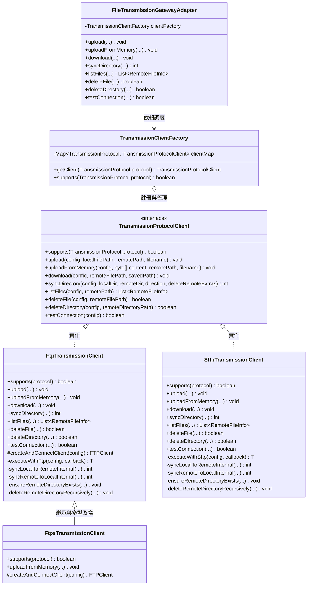
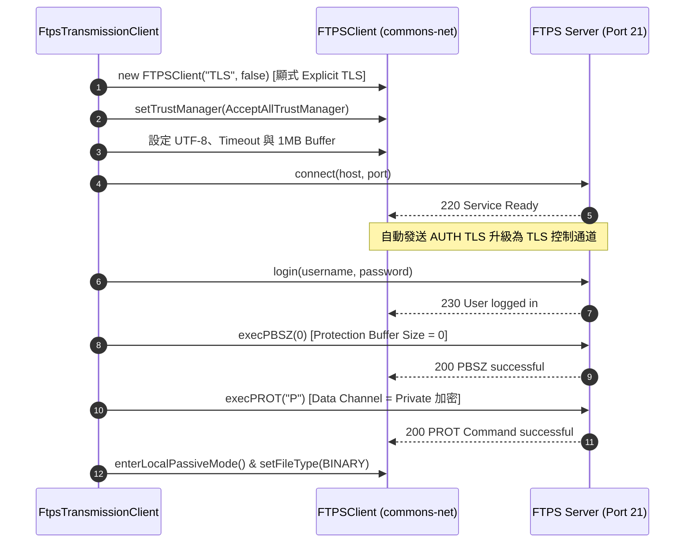
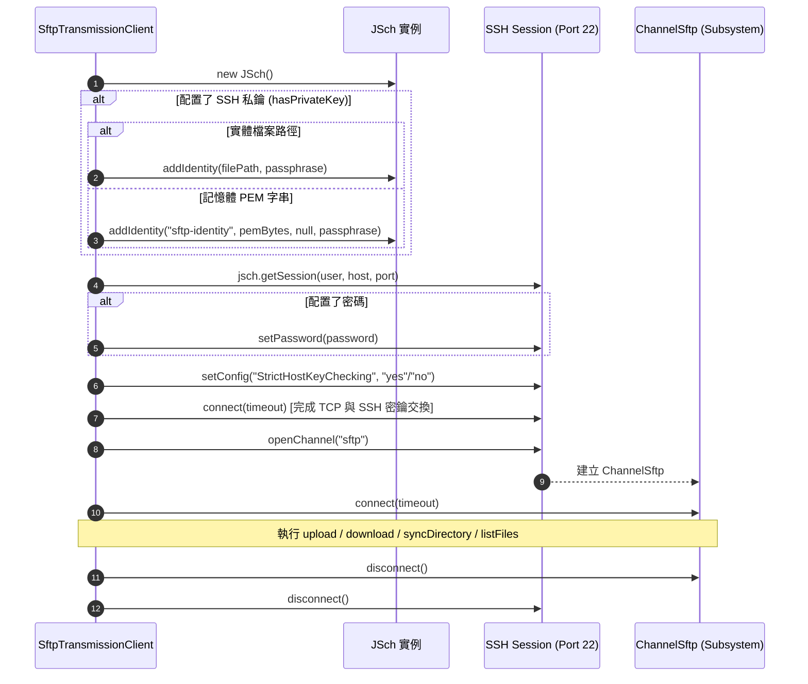

# 傳輸協定客戶端架構分析與維運指南 (Transmission Clients Architecture & Maintenance Guide)

> **版本**：1.0.0  
> **適用模組**：`file-transmission-module`  
> **維護路徑**：`doc/maintainance/TRANSMISSION_CLIENTS_ANALYSIS_GUIDE.md`  
> **關聯核心類別**：
> - [`TransmissionProtocolClient`](file:///d:/桌面/ModuleWorkSpace/file-transmission-module/src/main/java/com/example/demo/infrastructure/transmission/client/TransmissionProtocolClient.java)
> - [`FtpTransmissionClient`](file:///d:/桌面/ModuleWorkSpace/file-transmission-module/src/main/java/com/example/demo/infrastructure/transmission/client/impl/FtpTransmissionClient.java)
> - [`FtpsTransmissionClient`](file:///d:/桌面/ModuleWorkSpace/file-transmission-module/src/main/java/com/example/demo/infrastructure/transmission/client/impl/FtpsTransmissionClient.java)
> - [`SftpTransmissionClient`](file:///d:/桌面/ModuleWorkSpace/file-transmission-module/src/main/java/com/example/demo/infrastructure/transmission/client/impl/SftpTransmissionClient.java)
> - [`TransmissionClientFactory`](file:///d:/桌面/ModuleWorkSpace/file-transmission-module/src/main/java/com/example/demo/infrastructure/transmission/factory/TransmissionClientFactory.java)

---

## 1. 概述與架構定位

在現代企業級整合架構中，異質系統間的批次檔案交換通常依賴不同的網路傳輸協定。本模組在 **Clean Architecture 六角形架構 (Hexagonal Architecture)** 與 **領域驅動設計 (DDD)** 規範下，將底層傳輸技術完整封裝於基礎設施層 (`infrastructure/transmission/client/`) 內部，使應用層 (Application Layer) 與表現層 (Presentation Layer) 能以高度抽象且純粹的業務介面與領域模型操作檔案傳輸，達成與具體網路函式庫的徹底解耦。

本模組內建支援三大主流檔案傳輸協定客戶端：
1. **`FtpTransmissionClient`**：基於 Apache Commons Net，處理標準明文 FTP 通訊。
2. **`FtpsTransmissionClient`**：繼承自 FTP 客戶端，實作符合 RFC 4217 規範之 Explicit TLS/SSL 安全加密傳輸。
3. **`SftpTransmissionClient`**：基於 JSch，運作於 SSHv2 加密通道上的安全檔案傳輸協定。

---

## 2. 類別架構與設計模式

### 2.1 類別關聯圖 (Class Diagram)



### 2.2 核心設計模式應用

1. **策略模式 (Strategy Pattern)**：
   - 表現層與應用層僅依賴協定列舉 `TransmissionProtocol`（`FTP`, `FTPS`, `SFTP`），由 `TransmissionClientFactory` 動態解析並派發至具體的技術客戶端實例。
2. **樣板回呼模式 (Template Callback Pattern)**：
   - `FtpTransmissionClient` 的 `executeWithFtp(...)` 與 `SftpTransmissionClient` 的 `executeWithSftp(...)` 負責封裝連線建立、TLS/SSH 交握、身分驗證，並在 `finally` 區塊強制執行登出與 `disconnect()`，業務邏輯透過 Functional Interface 回呼執行，**根除 Socket 與連線洩漏風險**。
3. **消除全域靜態連線 (Thread-Safe Isolation)**：
   - 徹底拔除舊版靜態變數（如 `static Session`、`static ChannelSftp`），每次傳輸皆在呼叫執行緒上下文中建立專屬連線物件，確保多執行緒並發執行時互不干擾。
4. **防腐與例外轉譯 (Anti-Corruption & Exception Translation)**：
   - 捕捉底層技術例外（Apache Commons Net 的 `IOException`、JSch 的 `JSchException` 與 `SftpException`），統一轉譯為應用層理解之領域例外：
     - 連線或認證失敗：`TransmissionConnectionException`
     - 傳輸讀寫或業務異常：`FileTransmissionException`
     - 遠端目錄建立失敗：`RemoteDirectoryCreationException`

---

## 3. 三大客戶端核心特徵對比矩陣

| 比較維度 | `FtpTransmissionClient` | `FtpsTransmissionClient` | `SftpTransmissionClient` |
| :--- | :--- | :--- | :--- |
| **底層技術庫** | Apache Commons Net (`3.11.1`) | Apache Commons Net (`3.11.1`) | JSch (`com.github.mwiede:jsch:0.2.21`) |
| **通訊協定** | File Transfer Protocol (標準明文) | FTP over SSL/TLS (RFC 4217) | SSH File Transfer Protocol (SSHv2 子系統) |
| **預設連接埠** | **21** (控制通道) | **21** (顯式 Explicit TLS) | **22** (標準 SSH 連接埠) |
| **加密通道設計** | **無加密**（指令與資料均為明文） | **TLS 1.2 / 1.3 雙通道加密**<br>控制通道 (TLS) + 資料通道 (`PROT P` 加密) | **SSH 封裝單一通道**<br>所有傳輸與指令皆在 SSH 密碼隧道內 |
| **網路連線架構** | **雙通道** (控制連線 + 隨機資料連線) | **雙通道** (控制連線 + 隨機資料連線) | **單一 TCP 連線** (指令與資料復用同一通道) |
| **防火牆 / NAT 穿越**| 需配置被動模式 (`PASV`)<br>且防火牆需開啟 Ephemeral 連接埠範圍 | 需配置被動模式 (`PASV`)<br>且防火牆需開啟 Ephemeral 連接埠範圍 | **極佳**，僅需開放單一 Port 22，穿越防火牆與容器網路最友善 |
| **身分認證方式** | 帳號 + 密碼 | 帳號 + 密碼 (+ 可選客戶端 TLS 憑證) | 帳號 + 密碼 / **SSH 私鑰金鑰認證 (PEM/檔案/Passphrase)** |
| **大檔傳輸緩衝區** | 內建配置 **1MB** I/O Buffer | 內建配置 **1MB** I/O Buffer | JSch 串流管道預設視窗緩衝 |
| **目錄遞迴建立** | 逐層 `CWD` + `MKD` 容錯補齊 | 繼承 FTP 逐層 `CWD` + `MKD` | 前置 `cd` 探測 + 逐層 `mkdir` 補齊 |
| **增量同步比對依據**| 遠端檔案清單快取 + 檔名比對 / 時間戳記 | 遠端檔案清單快取 + 檔名比對 / 時間戳記 | 遠端 `SftpATTRS.getMTime()` (毫秒級修改時間) |
| **記憶體直傳 (Zero Disk I/O)**| **原生支援** (`byte[]` -> `storeFile` 串流) | **原生支援** (繼承 FTP，自動享 TLS 加密保護) | **原生支援** (`byte[]` -> `put` SSH 串流) |
| **程式碼實作方式** | 獨立實作 `TransmissionProtocolClient` | **繼承** `FtpTransmissionClient` 並覆寫連線工廠 | 獨立實作 `TransmissionProtocolClient` |

---

## 4. 各客戶端架構深度解析

### 4.1 FtpTransmissionClient (標準明文 FTP)

#### 架構定位與技術特點
`FtpTransmissionClient` 是傳統檔案傳輸的基礎實作，採用 Apache Commons Net 的 `FTPClient`。它適合運行在受信任的內網環境或封閉式專用網路（如企業內網封閉 VLAN）。

#### 連線建立流程 (`createAndConnectClient`)
1. **實例化與字元編碼**：建立 `FTPClient` 並將控制通道編碼強制鎖定為 `UTF-8`，徹底解決多國語言與中文檔名亂碼問題。
2. **逾時參數配置**：
   - `ConnectTimeout`：TCP Socket 建立連線逾時（毫秒）。
   - `DataTimeout`：採用現代化 `Duration.ofMillis(...)` 設定資料通道傳輸逾時，防止網路無預警斷線時執行緒無限期 Hang 住。
   - `DefaultTimeout`：控制通道指令傳送與回應接收之逾時。
3. **吞吐量優化**：呼叫 `setBufferSize(1024 * 1024)` 配置 1MB 串流緩衝區，有效減少底層 TCP 封包片段讀寫頻率。
4. **回應碼校驗 (ReplyCode)**：發起 TCP 連線後檢查回應碼是否為肯定完成狀態 (`FTPReply.isPositiveCompletion(replyCode)`)，非 `2xx` 狀態（如連線數滿載、IP 被封鎖）立即主動斷開並拋出 `TransmissionConnectionException`。
5. **被動模式 (Passive Mode)**：依設定呼叫 `enterLocalPassiveMode()`，指示伺服器開放隨機資料埠由客戶端連入，防止客戶端位於 NAT/防火牆後方時傳輸失敗。
6. **二進位模式鎖定**：強制設定 `setFileType(FTP.BINARY_FILE_TYPE)`，禁止使用 FTP 預設的 ASCII 模式，防止轉換換行符號造成圖片、ZIP、PDF 等二進位檔案損壞。

#### 核心作業機制
- **目錄遞迴建立 (`ensureRemoteDirectoryExists`)**：將路徑以 `/` 切割，逐層嘗試 `changeWorkingDirectory(dir)`；若失敗則發送 `makeDirectory(dir)` 建立該層目錄並進入，容錯補齊多層巢狀結構。
- **孤兒檔案清理 (`deleteRemoteExtras`)**：同步本機至遠端時，若啟用此旗標，會比對本機與遠端目錄，凡遠端多餘之檔案或目錄將被自動遞迴清理 (`deleteRemoteDirectoryRecursively`)。

---

### 4.2 FtpsTransmissionClient (FTPS 安全加密傳輸)

#### 繼承優勢與架構極簡化
`FtpsTransmissionClient` 繼承自 `FtpTransmissionClient`。得益於良好物件導向封裝，檔案上傳、下載、目錄遞迴走訪、時間戳記比對與刪除等高達 90% 的業務邏輯**完全重用父類別實作**，子類別僅專注於安全通道與 TLS 加密的建立。

#### 連線與加密流程 (`createAndConnectClient`)


#### RFC 4217 安全協定關鍵參數
1. **顯式加密 (Explicit TLS / FTPES)**：
   - 建構子傳入 `"TLS", false`。客戶端連線至標準 Port 21，先建立明文控制通道，隨後立即發送 `AUTH TLS` 握手升級為 TLS 加密通道。
   - 相較於過時的隱式加密 (Implicit SSL，通常使用 Port 990 且全流程 SSL)，顯式加密為 RFC 4217 標準推薦規範。
2. **`execPBSZ(0)` (Protection Buffer Size)**：
   - 規範要求在協商資料通道前必須先傳送 PBSZ。在 TLS 加密模式下緩衝區長度必須明確宣告為 `0`。
3. **`execPROT("P")` (Data Channel Protection Level)**：
   - 關鍵安全性命令！將資料保護等級設定為 `P` (Private)。若未設定或誤設為 `C` (Clear)，控制通道雖有加密，但**檔案實際傳輸的資料通道將退回明文裸奔**，極易遭竊聽。
4. **信任管理器 (TrustManager)**：
   - 預設注入 `TrustManagerUtils.getAcceptAllTrustManager()`，相容測試環境與私有自簽憑證；生產環境若需校驗 CA 憑證鏈，可在此快速抽換為驗證特定 KeyStore 的信任策略。

---

### 4.3 SftpTransmissionClient (SFTP over SSH)

#### 技術本質與通道模型
SFTP (SSH File Transfer Protocol) 與 FTP/FTPS 毫無親緣關係。它不是在 FTP 之上加掛加密層，而是完全構建於 **SSH-2 (Secure Shell)** 協定內部的子系統 (Subsystem `sftp`)。

#### 連線與認證流程 (`executeWithSftp`)


#### 核心優勢與關鍵設計
1. **多元身分認證 (Authentication)**：
   - **密碼認證**：標準帳號密碼登入。
   - **私鑰認證 (Publickey)**：支援本機金鑰檔案路徑或純文字 PEM 格式（方便儲存於加密資料庫或雲端 Secrets Manager），並支援 Passphrase 密碼短語解密。
2. **單一連線通道 (Single Port Architecture)**：
   - 僅佔用一個 TCP 連接埠（預設 22），所有指令、控制訊號與檔案資料流全數多工復用 (Multiplexed) 於該 SSH 連線中。**完全免除 FTP/FTPS 資料通道需穿越防火牆隨機高通訊埠的困擾**。
3. **智慧時間戳記增量同步 (Incremental Sync)**：
   - 在 `syncLocalToRemoteInternal` 與 `syncRemoteToLocalInternal` 中，直接透過 `ChannelSftp.LsEntry` 的 `SftpATTRS.getMTime()`（精確至秒，內部轉為毫秒）比對本機檔案 `lastModified()`，僅傳輸版本較新的異動檔案。
   - 下載完成後自動呼叫 `subLocalFile.setLastModified(remoteTime)`，維持本機與遠端檔案時間戳記一致性。
4. **快速路徑探測 (`ensureRemoteDirectoryExists`)**：
   - 建立目錄前先執行 `sftp.cd(remotePath)` 快速前置探測；若目錄已存在則直接返回（Fast Path），省去分割路徑與多次遠端往返開銷。

---

### 4.4 記憶體直傳機制 (Zero Disk I/O Memory Upload)

#### 業務痛點與技術需求
在雲原生容器化、高並發 API 或暫存性報表產製情境中，應用系統常需將記憶體動態生成的內容（如 Jasper/Poi 產製的 PDF/Excel 報表、自外部 REST API 接收之二進位串流、或資料庫導出的加密資料）直接傳輸至遠端伺服器。
- **傳統落盤痛點**：需先透過 `File.createTempFile` 寫入本機磁碟，傳輸完畢後再手動刪除暫存檔。若遇伺服器無預警崩潰或磁碟 I/O 壅塞，極易產生磁碟碎裂、殘留敏感個資與暫存檔外洩風險。
- **直傳架構優勢**：透過 `uploadFromMemory(config, byte[] content, remotePath, filename)`，資料以二進位位元組陣列直接轉換為串流送入網路通道，**達成完全不落地 (Zero Disk I/O)**，兼顧極致效能與資安合規。

#### 各客戶端實作特點
1. **`FtpTransmissionClient`**：
   - 驗證 `content != null`，將位元組包裝為 `ByteArrayInputStream`。
   - 自動調度 `ensureRemoteDirectoryExists` 確保遠端目標目錄存在。
   - 透過 `ftpClient.storeFile(filename, inputStream)` 以 Binary 串流直接寫入遠端。
2. **`FtpsTransmissionClient`**：
   - 完全複用父類別的直傳邏輯，並在建立 FTPS 連線時強制啟用 `AUTH TLS` 與 `execPROT("P")`。
   - 記憶體位元組於網路傳輸全程受到 TLS 密鑰保護，適合機敏財務報表與法規合規資料交換。
3. **`SftpTransmissionClient`**：
   - 將位元組包裝為 `ByteArrayInputStream`，前置確保遠端目錄結構。
   - 調度 JSch 實體通道之 `sftp.put(inputStream, targetFilePath)`，於 SSH 隧道中高效傳輸。

#### 對外開放之 REST API 端點 (`POST /api/transmission/upload/file`)
- **請求格式**：`multipart/form-data`
- **參數結構**：
  - `file` (必填，二進位檔案串流)：前端或客戶端上傳的原始檔案。
  - `host` (必填)：遠端主機 IP 或網域名稱。
  - `port` (選填)：通訊埠 (SFTP 預設 22，FTP 預設 21)。
  - `protocol` (必填)：`SFTP`、`FTP` 或 `FTPS`。
  - `username` (必填)：登入使用者帳號。
  - `password` (選填)：登入密碼 (支援明文或 `ENC(...)` 加密密文)。
  - `remotePath` (必填)：遠端存放目標目錄 (如 `/remote/upload`)。
  - `filename` (選填)：遠端儲存檔名 (若留空則自動沿用上傳檔案原始檔名)。
  - 其他可選配置：`timeoutMs`, `passiveMode`, `strictHostKeyChecking`, `privateKey`, `passphrase`。
- **cURL 呼叫範例**：
  ```bash
  curl -X POST "http://localhost:8080/api/transmission/upload/file" \
       -F "file=@/local/path/report.pdf" \
       -F "host=sftp.example.com" \
       -F "port=22" \
       -F "protocol=SFTP" \
       -F "username=sftpuser" \
       -F "password=secret123" \
       -F "remotePath=/remote/data" \
       -F "filename=monthly-report.pdf"
  ```
- **六角形調度架構**：
  `Controller (MultipartFile)` &rarr; `Assembler (extract byte[])` &rarr; `UploadFileFromMemoryCommand` &rarr; `UploadFileFromMemoryUseCase` &rarr; `FileTransmissionGatewayPort.uploadFromMemory` &rarr; `ProtocolClient (ByteArrayInputStream)` &rarr; `Remote Server`

---

## 5. 網路拓撲與防火牆配置維運指南

### 5.1 FTP / FTPS 雙通道架構 vs SFTP 單通道架構

```
【FTP / FTPS 網路架構】
+-----------------------+              控制通道: TCP 21 (明文或 TLS 命令)
| 應用伺服器 (Client)    | ---------------------------------------------> +-----------------------+
| (位於 NAT / 防火牆後方)|              資料通道: 隨機被動高埠 (PASV: 1024~65535)   | FTP / FTPS 伺服器     |
+-----------------------+ ---------------------------------------------> +-----------------------+
                                (防火牆必須對外開放隨機 Ephemeral 埠範圍)

【SFTP 網路架構】
+-----------------------+              單一 SSH 連線: TCP 22 (所有指令與資料)
| 應用伺服器 (Client)    | ---------------------------------------------> +-----------------------+
| (位於 NAT / 防火牆後方)|                                                | SFTP (SSH) 伺服器    |
+-----------------------+                                                +-----------------------+
                                (僅需開放單一 Port 22，極其安全簡潔)
```

### 5.2 防火牆與 NAT 常見踩坑點
1. **FTPS 資料通道被擋**：
   - FTP 伺服器回傳的 `PASV` 回應包含資料埠與 IP。若伺服器位於 NAT 後方且未配置外網 Public IP，回傳私有 IP (如 `192.168.x.x`) 會導致客戶端連線超時。
   - 維運對策：請伺服器端管理者在 FTP 軟體設定 `PasvAddress` (宣告外網 IP) 與 `PasvMinPort / PasvMaxPort` (限制被動埠範圍，例如 50000~51000)，並於防火牆放行該埠區段。
2. **SFTP StrictHostKeyChecking 策略**：
   - 開發/測試環境：可設定為 `no`，避免因遠端主機重建金鑰導致連線被阻擋。
   - 正式生產環境：建議配置 `yes` 並在作業系統配置標準的 `known_hosts`，有效杜絕中間人攻擊 (Man-in-the-Middle, MITM)。

---

## 6. 維運排查手冊 (Troubleshooting FAQ)

| 異常現象 / 錯誤訊息 | 可能肇因 | 維運處置建議 |
| :--- | :--- | :--- |
| **`ReplyCode: 550 Permission denied`** | 遠端使用者目錄權限不足、配額已滿或檔案被其他行程鎖定 | 1. 檢查遠端目錄所有權與讀寫權限 (`chmod 755 / chown`)<br>2. 檢查遠端磁碟配額 (Disk Quota) 是否已滿 |
| **`ReplyCode: 550 File not found`** | 來源檔案路徑錯誤或遠端目錄尚未建立 | 1. 檢核遠端目錄與路徑大小寫（Linux 伺服器區分大小寫）<br>2. 確認呼叫前是否成功觸發 `ensureRemoteDirectoryExists` |
| **`FTPS 連線成功但卡在讀寫 (Timeout)`** | 資料通道遭防火牆阻擋，或未啟用被動模式 | 1. 檢核 `TransmissionServerConfig.isPassiveMode()` 是否為 `true`<br>2. 確認網路防火牆是否放行 FTP 伺服器的被動通訊埠區間 |
| **`JSchException: Auth fail`** | 帳號密碼錯誤、私鑰不符合或私鑰 Passphrase 錯誤 | 1. 驗證帳號密碼是否正確<br>2. 若使用私鑰認證，確認金鑰格式為 OpenSSH / PEM 且 Passphrase 正確<br>3. 檢查伺服器端 `~/.ssh/authorized_keys` 權限是否為 `600` |
| **`JSchException: Reject HostKey`** | 遠端主機金鑰變更，觸發了嚴格主機檢驗 | 1. 若為動態環境，可將 `strictHostKeyChecking` 設定為 `false`<br>2. 若為生產環境，請更新本機 `known_hosts` 信任清單 |
| **檔案傳輸後二進位損壞 (圖檔破圖、ZIP 損壞)** | 傳輸模式被誤設為 ASCII 模式 | 本模組已強制鎖定 `BINARY_FILE_TYPE`。若外部客戶端介接，請確保絕不可使用 ASCII 傳輸模式 |
| **中文檔名出現亂碼或 `?` 字符** | 控制通道編碼未對齊 UTF-8 | 本模組預設強制啟用 UTF-8 編碼。請確認遠端伺服器 (如 vsftpd/FileZilla) 是否亦開啟 UTF-8 支援 |
| **大量傳輸時伺服器回傳連線數超限** | 連線釋放不及造成連線數耗盡 | 本模組全數採用 `executeWithFtp` / `executeWithSftp` 於 `finally` 區塊斷線。若為高頻傳輸，建議呼叫非同步長任務模式 (`/api/transmission/sync/async`) |

---

## 7. 總結與選型建議

1. **優先推薦：`SFTP`**
   - 具備單一通訊埠架構、現代 SSH 傳輸層加密、金鑰身分認證與毫秒級增量比對，為雲端環境、跨資料中心與微服務架構的最佳首選。
2. **次佳推薦：`FTPS`**
   - 適用於合作夥伴或歷史舊系統僅支援 FTP 協定，但資安合規嚴格要求傳輸加密之情境。請務必保持 `PROT P` 與被動模式。
3. **特許/相容推薦：`FTP`**
   - 僅建議於封閉無外部連線之內網專用隔離網段，或內部測試環境中使用。禁止於公網傳送機敏營運資料。
