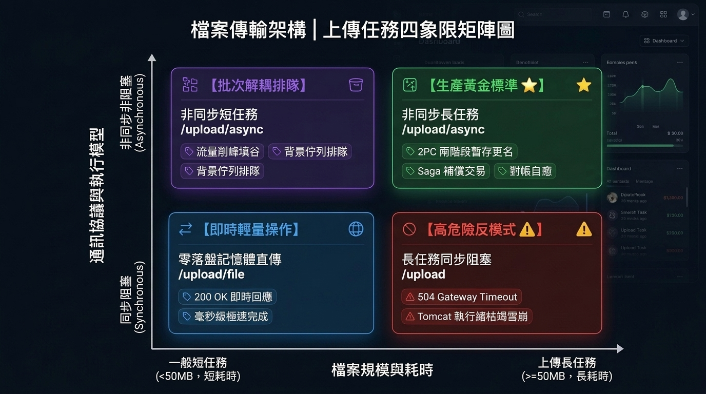
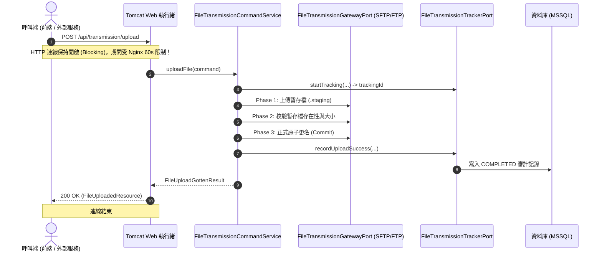
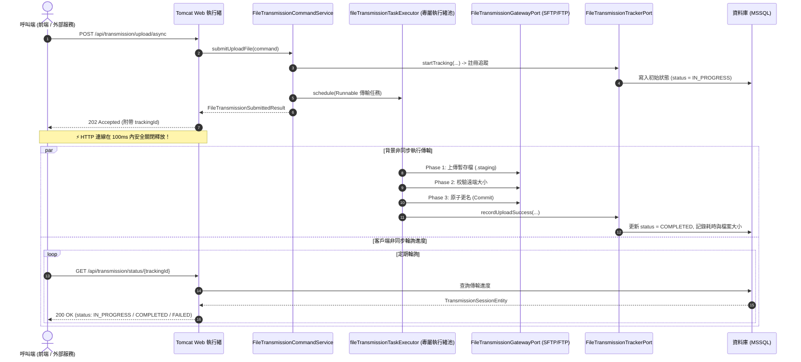

# 檔案上傳架構指南：同步 vs 非同步 與 一般任務 vs 上傳長任務剖析 (Upload Tasks Architectural Guide)

> **版本**：1.0.0  
> **適用模組**：`file-transmission-module`  
> **文件歸檔路徑**：`doc/maintainance/UPLOAD_TASK_SYNC_VS_ASYNC_AND_LONG_RUNNING_GUIDE.md`  
> **關聯規範**：[AGENTS.md](../../.agents/AGENTS.md) | [EVENTUAL_CONSISTENCY_AND_COMPENSATION_GUIDE.md](EVENTUAL_CONSISTENCY_AND_COMPENSATION_GUIDE.md)

---

## 1. 概述與架構背景 (Overview & Context)

在企業級分散式系統中，**「檔案上傳」**看似是一個單純的 I/O 操作，但其業務場景在**資料規模、網路頻寬、耗時長短與容錯需求**上往往存在天壤之別：
- 一次使用者頭像或 PDF 發票的上傳，體積僅數十 KB 至數 MB，傳輸耗時在數百毫秒內即可完成；
- 一次跨國資料庫備份檔 (`.tar.gz` / `.bak`)、大型影像檔案或批次報表資料的推送，體積動輒數百 MB 至數十 GB，耗時長達數分鐘甚至數小時。

如果系統採用單一架構模式處理所有上傳，將迅速面臨**「Tomcat Web 執行緒池枯竭」、「閘道反向代理 504 Gateway Timeout」、「傳輸中斷產生半截殘檔」、「OOM 記憶體溢位」**等嚴峻的生產事故。

因此，本模組在架構設計上將上傳任務從兩個**互相正交 (Orthogonal) 的核心維度**進行解構：
1. **維度一：通訊與執行模型** —— **「同步上傳 (Synchronous)」** vs **「非同步上傳 (Asynchronous)」**。
2. **維度二：任務規模與耗時性質** —— **「一般上傳任務 (Regular/Short Upload)」** vs **「上傳長任務 (Long-Running Upload)」**。

本文將深入剖析這兩個維度的本質區別、底層運作機制、潛在風險以及系統對應的防禦性設計。




| 象限分類 | 短耗時 / 小檔案 (< 50MB) | 長耗時 / 大檔案 (≥ 50MB) |
| :--- | :--- | :--- |
| **非同步通訊 (Asynchronous)** | **【批次解耦排隊】**<br>• 端點：`/upload/async`<br>• 特徵：202 Accepted、削峰填谷、非阻塞 | **【生產黃金標準 ⭐】**<br>• 端點：`/upload/async` + 輪詢<br>• 特徵：2PC 暫存更名、Saga 補償、對帳自癒 |
| **同步通訊 (Synchronous)** | **【即時輕量操作】**<br>• 端點：`/upload/file` (記憶體直傳) 或 `/upload`<br>• 特徵：200 OK、零落盤直傳、毫秒級完成 | **【高危險反模式 ⚠️】**<br>• 嚴重後果：504 Gateway Timeout<br>• 風險：Tomcat 執行緒池枯竭、雪崩癱瘓 |

---

## 2. 維度一：上傳任務「同步」與「非同步」的區別

「同步」與「非同步」主要描述的是**客戶端（調用方）與伺服器之間的通訊協議行為、連線維持方式以及執行緒佔用模式**。

### 2.1 核心架構對比矩陣

| 比較項目 | 同步上傳 (Synchronous Upload) | 非同步上傳 (Asynchronous Upload) |
| :--- | :--- | :--- |
| **代表性 API 端點** | `POST /api/transmission/upload`<br>`POST /api/transmission/upload/file` | `POST /api/transmission/upload/async` |
| **HTTP 回應狀態碼** | **`200 OK`**（伺服器完全處理完畢才回應） | **`202 Accepted`**（僅完成任務登記即刻回應） |
| **回應載體物件** | [FileUploadedResource](file:///d:/桌面/ModuleWorkSpace/file-transmission-module/src/main/java/com/example/demo/presentation/resource/out/FileUploadedResource.java)<br>(底層 DTO: [FileUploadGottenResult](file:///d:/桌面/ModuleWorkSpace/file-transmission-module/src/main/java/com/example/demo/application/shared/dto/FileUploadGottenResult.java)) | [FileTransmissionSubmittedResource](file:///d:/桌面/ModuleWorkSpace/file-transmission-module/src/main/java/com/example/demo/presentation/resource/out/FileTransmissionSubmittedResource.java)<br>(底層 DTO: [FileTransmissionSubmittedResult](file:///d:/桌面/ModuleWorkSpace/file-transmission-module/src/main/java/com/example/demo/application/shared/dto/FileTransmissionSubmittedResult.java)) |
| **連線生命週期** | **阻塞長連 (Blocking)**：HTTP 連線全程保持開啟，直到遠端寫入完畢 | **瞬時握手 (Non-blocking)**：約 50~100ms 內完成鑑權與註冊，連線立即斷開釋放 |
| **執行緒模型** | 佔用 **Tomcat Web 工作執行緒 (Worker Thread)** | 釋放 Web 執行緒，派發至專屬 **ThreadPoolTaskExecutor** |
| **結果獲取模式** | 單次 Request 的 Response 直接取得結果 | 透過 `GET /api/transmission/status/{trackingId}` 輪詢取得 [TransmissionStatusGottenResource](file:///d:/桌面/ModuleWorkSpace/file-transmission-module/src/main/java/com/example/demo/presentation/resource/out/TransmissionStatusGottenResource.java) |
| **反向代理逾時風險** | **高**。超過 Nginx/ALB 限制 (通常 60s) 即拋出 `504 Gateway Timeout` | **零**。HTTP 請求於毫秒級收尾，後續傳輸與 HTTP 閘道連線無關 |
| **伺服器併發能力影響** | 併發數受限於 Tomcat 執行緒池上限 (預設 200)，易導致**執行緒耗盡 (Thread Starvation)** | 獨立執行緒池與排程佇列隔離，**完全不影響系統其餘 Web API 的吞吐量** |
| **失敗與異常處理** | 異常由全域攔截器 (`GlobalExceptionHandler`) 直接回傳 HTTP 4xx/5xx | 透過 Outbound Port 將失敗原因寫入資料庫實體，客戶端輪詢時呈現，並觸發自動補償 |

---

### 2.2 循序圖解析 (Sequence Diagrams)

#### (1) 同步上傳循序圖 (Blocking Flow)
客戶端發起請求後，Tomcat 執行緒必須等待遠端 2PC (Staging -> Verifying -> Committing) 全程完成才能回傳 `200 OK`：



#### (2) 非同步上傳循序圖 (Non-blocking & Polling Flow)
客戶端呼叫後立即拿到 `trackingId` 與 `202 Accepted`，傳輸作業由背景執行緒接管：



---

## 3. 維度二：「一般上傳任務」與「上傳長任務」的區別

「一般任務」與「長任務」主要描述的是**傳輸對象的物理規模、預期耗時長短以及系統對資料完整性、容錯自癒架構的要求等級**。

### 3.1 什麼定義了「上傳長任務」？

| 特徵維度 | 一般上傳任務 (Regular Task) | 上傳長任務 (Long-Running Task) |
| :--- | :--- | :--- |
| **檔案體積 (File Size)** | **< 50 MB**（文字、圖檔、普通 PDF、單據） | **50 MB ~ 數十 GB**（DB 備份壓縮檔、日誌包、影音串流檔） |
| **網路環境 (Network)** | 內部高速區域網路 (LAN) 或低延遲專線 | 跨廣域網 (WAN)、公網、跨國慢速線路、高抖動無線網路 |
| **預期耗時 (Duration)** | **< 3 ~ 5 秒**（通常在數百毫秒內） | **數十秒至數小時** |
| **中斷風險率** | 極低（短暫傳輸幾乎不遭遇網路閃斷） | **極高**（傳輸時間越長，遭遇網路瞬斷、伺服器重啟的機率成倍上升） |
| **重試成本** | 極低（直接整檔重發一次即可） | **極高**（重傳需消耗大量頻寬與時間，必須具備斷點或殘檔清理能力） |

---

### 3.2 關鍵技術指標與架構差異剖析

#### 1. 記憶體管理與 I/O 策略 (Memory Strategy vs. Chunked Streaming)
- **一般上傳任務**：
  - 可以採用 **零磁碟落盤記憶體直傳 (Zero Disk I/O)**。
  - 例如 `POST /api/transmission/upload/file` 端點，前端以 HTTP Multipart 表單傳入二進位串流，後端直接將 `byte[]` 或 `InputStream` 串接至遠端 SFTP/FTP 輸出埠。
  - **優點**：不佔用本機硬碟空間、無需管理暫存檔磁碟垃圾、省去二次磁碟 I/O。
- **上傳長任務**：
  - **嚴格禁止全量讀入 Java Heap 記憶體**！若同時有 5 個 1GB 的上傳長任務將資料轉為 `byte[]`，會瞬間將 JVM 堆記憶體塞爆，引發嚴重的 `java.lang.OutOfMemoryError: Java heap space` 與頻繁 Full GC。
  - 長任務必須採用 **以本機實體路徑 (`LocalFilePath`) 為錨點**，搭配固定大小緩衝區（如 32KB ~ 64KB）逐區塊串流寫入，保證 JVM 記憶體佔用恆定為 O(1)。

#### 2. 兩階段提交與防殘檔機制 (2PC Staging & Atomic Commit)
- **一般上傳任務**：
  - 若中斷或失敗，遠端頂多留下幾十 KB 的小檔，手動或覆蓋覆寫成本較低。
- **上傳長任務**：
  - 若在寫入中途網路斷線，遠端主機會殘留幾十 MB 的**「半截損毀檔案 (Corrupted Partial File)」**。若此時下游自動化系統（如 ETL 批次程序）直接取用，將引發嚴重的資料解析災難！
  - 模組對長任務強制實施 **2PC (兩階段提交模擬)**：
    1. **Phase 1 (STAGING)**：串流寫入隱藏暫存檔，格式為 `.{fileName}.staging.{trackingId}`。
    2. **Phase 2 (VERIFYING)**：寫入完成後，閘道呼叫遠端確認檔案存在，並比對遠端檔案大小是否 100% 符合本機大小。
    3. **Phase 3 (COMMITTING)**：大小確認一致後，發起原子更名 (`moveFile / rename`) 切換為正式檔名；若正式檔名已存在，則先自動備份為 `.{fileName}.bak.{timestamp}`。
  - 此機制徹底保證**「下游系統永遠只能看到 100% 完整寫入的正式檔案」**。

#### 3. 事務邊界與 Saga 補償交易 (Compensation Outbox)
- **一般上傳任務**：
  - 遭遇異常直接丟出 `FileTransmissionException`，由前端感知後重試。
- **上傳長任務**：
  - 長任務失敗時，除了拋出例外外，必須啟動分散式事務治理：
    1. **即時補償**：`catch` 區塊立即嘗試調用遠端刪除指令，刪除 `.staging` 殘留檔。
    2. **Outbox 最終一致性補償**：若連即時刪除指令都因網路完全斷線而失敗，系統會將刪除任務寫入本地 Outbox 補償表 (`transmission_compensation_task`)，由背景排程以指數退避演算法（Exponential Backoff，最高重試 5 次）持續重試清理，避免遠端磁碟爆滿。

#### 4. 可觀察性、審計與殭屍任務自癒 (Observability & Reconciliation)
- **一般上傳任務**：
  - 屬於無狀態 (Stateless) 或僅寫入應用程式 Console Log。
- **上傳長任務**：
  - **狀態審計追蹤**：長任務全程由 `FileTransmissionTrackerPort` 綁定 `TransmissionSessionEntity`，記錄任務的建立時間、完成時間、傳輸耗時（毫秒）、檔案大小與協定。
  - **殭屍任務對帳自癒 (Reconciliation)**：若伺服器在執行長任務時因斷電、重啟或 OOM Crash 導致背景執行緒非正常死亡，任務將永遠停滯在 `IN_PROGRESS`。模組內建 [ReconciliationScheduler](file:///d:/桌面/ModuleWorkSpace/file-transmission-module/src/main/java/com/example/demo/infrastructure/scheduler/ReconciliationScheduler.java)，定期巡檢超過 30 分鐘未更新的殭屍任務，自動校驗遠端狀態並進行自癒修正（補登 `COMPLETED` 或標記 `FAILED` 並清除暫存檔）。

---

## 4. 綜合比較表：一般上傳任務 vs 上傳長任務

| 核心維度 | 一般上傳任務 (Regular Task) | 上傳長任務 (Long-Running Task) |
| :--- | :--- | :--- |
| **檔案大小門檻** | **< 50 MB** | **≥ 50 MB**（至數十 GB） |
| **典型通訊模式** | **同步模式** (`/upload` 或 `/upload/file`) | **非同步模式** (`/upload/async`) |
| **I/O 模式** | 記憶體直傳 (Zero Disk I/O) 或本機快速讀取 | 固定 Buffer 串流讀寫、分塊傳輸 |
| **JVM 記憶體壓力** | 極低（瞬時佔用幾 MB 即被 GC 回收） | 必須嚴格限制為串流，防止 Heap 耗盡 |
| **執行緒池分配** | 可共用 Tomcat 預設 HTTP 執行緒池 | 隔離於專屬背景執行緒池 (`fileTransmissionTaskExecutor`) |
| **檔案覆寫與安全性** | 簡易覆寫或校驗 | **強制 2PC 暫存寫入、大小驗證、原子更名與舊檔備份** |
| **失敗殘檔清理機制** | 失敗直接回滾或忽略 | **Saga Outbox 補償交易與指數退避重試刪除** |
| **中斷與崩潰自癒** | 使用者手動重新點擊上傳 | **Reconciliation 背景巡檢定時自癒殭屍任務** |
| **日誌與追蹤等級** | 簡易 Application Log | 寫入 `TransmissionSessionEntity` 資料庫實體，具備完整審計指標 |

---

## 5. 實戰架構選型與呼叫決策樹 (Architectural Decision Tree)

當您要為前端或外部串接系統選擇合適的上傳 API 時，請遵循以下決策路徑：

```text
[新上傳任務需求]
       │
       ├─► 檔案體積是否大於 50MB？
       │      ├─► 是 ──► 【強烈建議】採用「非同步上傳長任務」：POST /api/transmission/upload/async
       │      │         (立即取得 trackingId，客戶端開啟輪詢或監聽)
       │      │
       │      └─► 否 ──► 檔案是否儲存於呼叫端本機硬碟？
       │                    ├─► 是 ──► 呼叫端是否能接受 1~3 秒阻塞等待？
       │                    │            ├─► 是 ──► 採用「同步本機上傳」：POST /api/transmission/upload
       │                    │            └─► 否 ──► 採用「非同步上傳長任務」：POST /api/transmission/upload/async
       │                    │
       │                    └─► 否 (為前端網頁 Form/Multipart 上傳串流)
       │                                 └─► 採用「記憶體零落盤直傳」：POST /api/transmission/upload/file
```

---

## 6. 生產環境反模式警告 (Anti-Patterns to Avoid)

> [!CAUTION]
> ### ⚠️ 嚴重反模式：對長任務使用同步模式 (Long-Running Task over Synchronous HTTP)
> **現象**：對一個 2GB 的檔案呼叫 `POST /api/transmission/upload` 進行同步傳輸。  
> **後果**：
> 1. **504 Gateway Timeout**：企業常見的 API Gateway 或 Nginx 預設反向代理逾時時間為 60 秒。一旦傳輸超過 60 秒，閘道自動斷開連線並向使用者返回 `504`，但後端伺服器仍傻傻地在背景繼續傳輸，造成嚴重的**「呼叫方認定失敗、伺服器端卻成功寫入」**狀態不一致問題。
> 2. **執行緒池耗盡 (Thread Exhaustion)**：若同時間有 50 個使用者進行同步大檔傳輸，將耗盡 Tomcat 的 200 個 Worker Thread，導致其他輕量級業務 API（如使用者登入、商品查詢）全部陷入排隊逾時，引發全站雪崩！

> [!WARNING]
> ### ⚠️ 記憶體直傳容量陷阱 (Memory Upload Size Pitfall)
> **現象**：對 `POST /api/transmission/upload/file` 傳送超過 100MB 的檔案。  
> **後果**：此端點設計為 Zero Disk I/O，以記憶體為緩衝直傳。當檔案過大時，Spring MVC 解析 Multipart 會佔用大量記憶體。系統已於 `application.properties` 配置 `spring.servlet.multipart.max-file-size=50MB` 進行硬性阻絕防護，超過上限之大檔案請務必引導改用本機落地路徑搭配 `/upload/async`。

---

## 7. 總結 (Summary)

1. **同步 vs 非同步**：本質是**「連線與執行緒排程方式」**的抉擇。短任務求即時選同步 (`200 OK`)；長耗時任務求穩定防逾時選非同步 (`202 Accepted + trackingId`)。
2. **一般任務 vs 長任務**：本質是**「資料規模、I/O 策略與分散式容錯等級」**的抉擇。一般任務重在輕量敏捷；長任務則必須嚴格落實 **2PC 暫存更名、Saga Outbox 補償與對帳自癒機制**，才能確保大數據量傳輸在極端網路與系統崩潰下的最終一致性。
